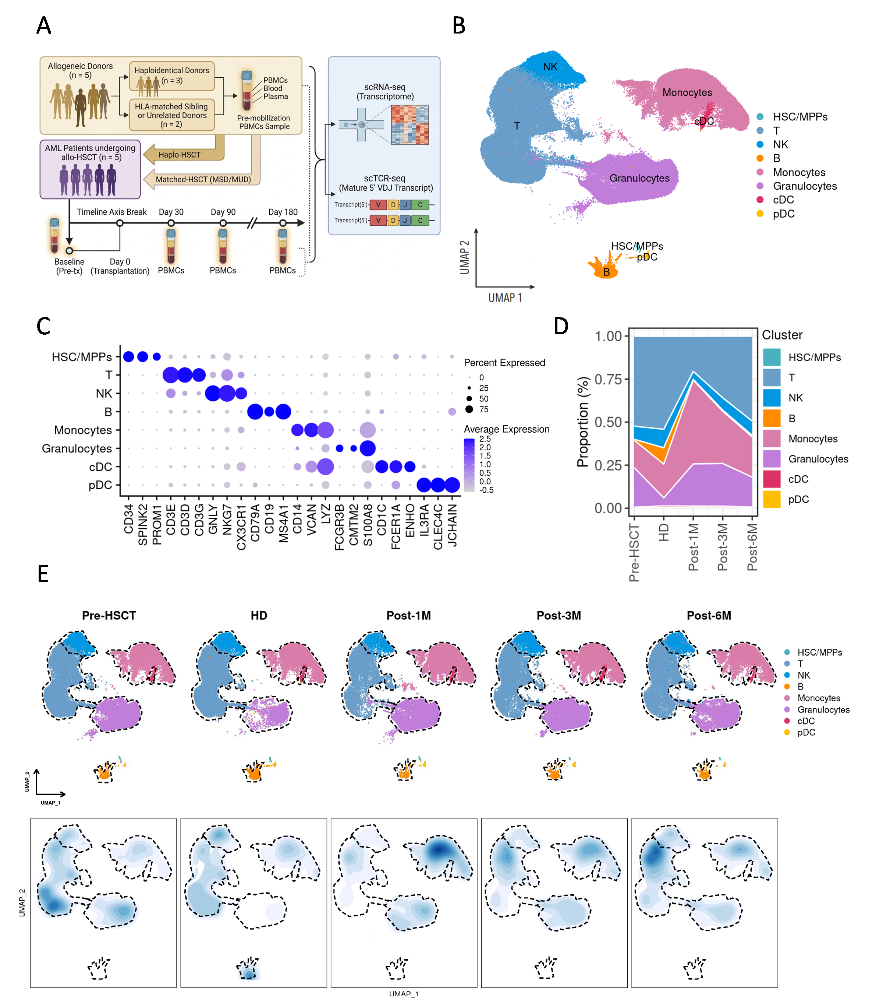

# Fig. 1 | Longitudinal single-cell atlas of peripheral blood immune reconstitution post-allo-HSCT.

Early reconstitution shifts toward myeloid cells, followed by numerical T cell recovery. The post-transplant T cell distribution remains distinct from healthy donors.

[PDF](Combined/M01.pdf) · [Original EMF](Combined/M01.emf)

(A) Schematic of the experimental design and longitudinal sampling. Peripheral blood mononuclear cells (PBMC) were collected from healthy donors (HD, n = 5) and AML patients (n = 5) at five critical time points: pre-mobilization (for donors), pre-conditioning (for recipients), at 1, 3, and 6 months post-transplantation (Post-1M, Post-3M, and Post-6M). All samples were subjected to paired single-cell RNA sequencing (scRNA-seq) and single-cell T cell receptor sequencing (scTCR-seq).

(B) Uniform Manifold Approximation and Projection (UMAP) visualization of the global immune landscape. UMAP plot displaying the integrated PBMC landscape across all samples, with clusters colored by annotated cell lineage. Major identified populations include HSC/MPPs, T cells, NK cells, B cells, monocytes, granulocytes, cDCs, and pDCs.

(C) Dot plot of canonical marker genes used for cell type annotation. Dot plot illustrating the average expression and fraction of cells expressing lineage-specific markers for each cluster defined in (B). Color intensity represents the scaled average expression level, while dot size indicates the proportion of cells expressing the gene within each cluster.

(D) Dynamic changes in immune cell composition. Stacked area plots depicting the relative proportions of major immune cell populations across HD, Pre-HSCT, and Post-HSCT time points (Post-1M, Post-3M, and Post-6M).

(E) UMAP projections stratified by sampling time point, with corresponding density maps showing the dynamic redistribution of cells across the global immune landscape during immune reconstitution. Notably, T cells exhibit a distinct local density distribution during the post-HSCT reconstruction process, differing significantly from both HD and Pre-HSCT baselines.

## Panel code and data

[A](a_M01a/README.md) · [B](b_M01b/README.md) · [C](c_M01c/README.md) · [D](d_M01d/README.md) · [E](e_M01e/README.md)

## Figure source and execution

Combined contains the exact EMF embedded in the supplied manuscript and raster PNG/PDF previews. Server panel exports are retained where located. Panel pages identify shared inputs and original scripts. Historical interactive scripts require the documented session objects; source fragments ending in `.source.txt` are not standalone programs.

Saved cell-level inputs and trajectory geometry are in [Primary shared inputs](../00_Global_Data/Shared_Inputs/Primary/README.md).
