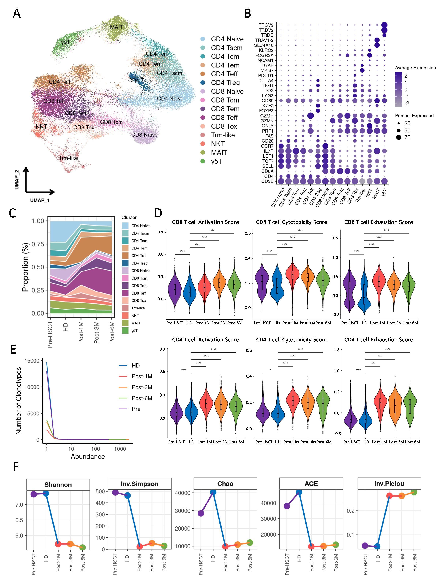

# Fig. 2 | Remodelling of T cell functional states and the TCR repertoire post-allo-HSCT.

T cell recovery is biased toward effector and exhausted states. Functional activation increases while the TCR repertoire remains restricted.

[PDF](Combined/M02.pdf) · [Original EMF](Combined/M02.emf)

(A) UMAP visualization of T cell sub-populations. Re-clustering analysis of the T cell compartment reveals 15 distinct transcriptional states. These include naive T cells (CD4+ Naive and CD8+ Naive); memory T cell subsets, comprising stem-like memory T cells (Tscm), central memory T cells (Tcm), and effector memory T cells (Tem); effector T cell subsets, consisting of effector T cells (Teff) and terminally exhausted T cells (Tex); as well as innate-like T cells, such as natural killer T cells (NKT), mucosal-associated invariant T cells (MAIT), and gamma-delta T (γδT) cells. 

(B) Dot plot illustrating the expression of lineage-specific and functional marker genes. 

(C) Temporal dynamics of T cell subset composition. Stacked area plot depicting the relative abundance of defined T cell subsets across HD, Pre-HSCT, Post-1M, Post-3M and Post-6M samples. 

(D) Violin plots displaying the distribution of scores for T cell activation, cytotoxicity, and terminal exhaustion across different stages. For the embedded boxplots, the bottom and top of the box are located at the 25th and 75th percentiles, respectively. The bars represent values more than 1.5 times the interquartile range from the border of each box. P values were calculated using the Wilcoxon rank-sum test (two-sided; ****P < 0.0001, ***P < 0.001, **P < 0.01, *P < 0.05, n.s., not significant)

(E) Clonotype abundance curves derived from paired scTCR-seq data, demonstrating skewing and contraction of the TCR repertoire post-allo-HSCT. 

(F) Longitudinal evaluation of TCR repertoire diversity. Comprehensive metrics including Shannon, inverse Simpson, Chao, ACE, and inverse Pielou indices, summarizing the dramatic loss of diversity and increase in clonal evenness post-allo-HSCT.

## Panel code and data

[A](a_M02a/README.md) · [B](b_M02b/README.md) · [C](c_M02c/README.md) · [D](d_M02d/README.md) · [E](e_M02e/README.md) · [F](f_M02f/README.md)

## Figure source and execution

Combined contains the exact EMF embedded in the supplied manuscript and raster PNG/PDF previews. Server panel exports are retained where located. Panel pages identify shared inputs and original scripts. Historical interactive scripts require the documented session objects; source fragments ending in `.source.txt` are not standalone programs.

Saved cell-level inputs and trajectory geometry are in [Primary shared inputs](../00_Global_Data/Shared_Inputs/Primary/README.md).
