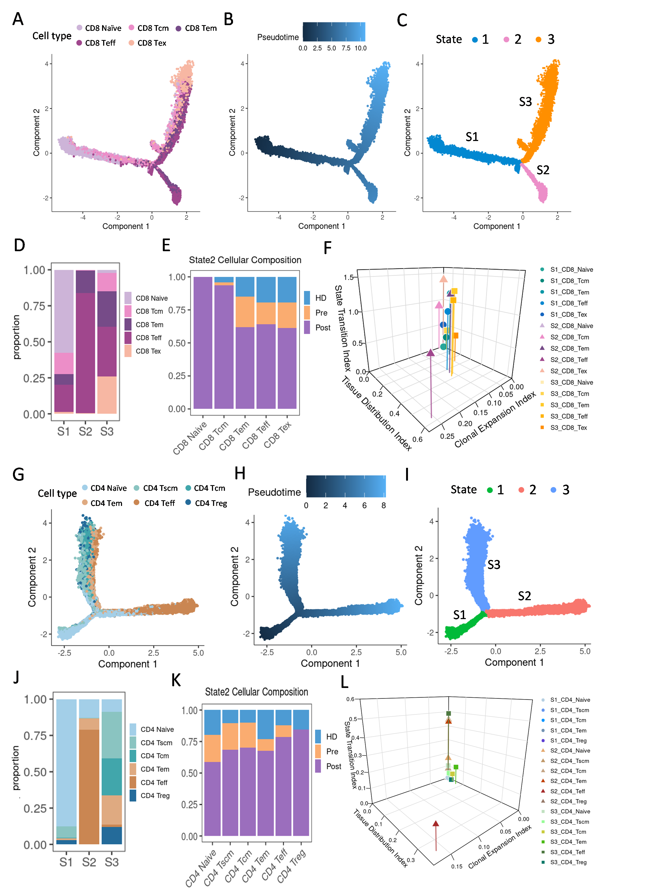

# Fig. 3 | Trajectory analysis identifies distinct state transitions in CD8 and CD4 T cells.

Trajectory and clonal analyses distinguish effector-rich states from naive and exhausted compartments in CD8 and CD4 T cells.

[PDF](Combined/M03.pdf) · [Original EMF](Combined/M03.emf)

(A-C) Developmental trajectory of CD8+ T cells. Monocle-based trajectory embedding of CD8+ T cells, colored by (A) transcriptional cell type, (B) developmental pseudotime, and (C) inferred cellular states (S1, S2, and S3), illustrating branching lineage commitment.

(D) Subpopulation distribution across CD8+ T cell states. Stacked bar plot showing the enrichment of specific T cell subsets.

(E) Condition-specific composition of CD8 subsets within State 2, showing the relative contributions from HD, Pre-HSCT, and Post-HSCT samples. 

(F) Three-dimensional integration of CD8+ T cell clonal features. A 3D scatter plot characterizing CD8+ T cell subsets across three dimensions: the clonal expansion index (x-axis), tissue distribution index (y-axis), and state transition index (z-axis). This model highlights the coupling between clonal proliferation and transcriptional state shifts. 

(G-I) Corresponding trajectory analysis of CD4+ T cells, colored by annotated cell type (G), pseudotime (H) or inferred cellular state (I). 

(J) Cell type composition of each inferred CD4 state. 

(K) Condition-specific composition of CD4 subsets within State 2. 

(L) Three-dimensional summary of the clonal expansion index (x-axis), tissue distribution index (y-axis), and state transition index (z-axis) for CD4 subsets and states.

## Panel code and data

[A](a_M03a/README.md) · [B](b_M03b/README.md) · [C](c_M03c/README.md) · [D](d_M03d/README.md) · [E](e_M03e/README.md) · [F](f_M03f/README.md) · [G](g_M03g/README.md) · [H](h_M03h/README.md) · [I](i_M03i/README.md) · [J](j_M03j/README.md) · [K](k_M03k/README.md) · [L](l_M03l/README.md)

## Figure source and execution

Combined contains the exact EMF embedded in the supplied manuscript and raster PNG/PDF previews. Server panel exports are retained where located. Panel pages identify shared inputs and original scripts. Historical interactive scripts require the documented session objects; source fragments ending in `.source.txt` are not standalone programs.

Saved cell-level inputs and trajectory geometry are in [Primary shared inputs](../00_Global_Data/Shared_Inputs/Primary/README.md).
