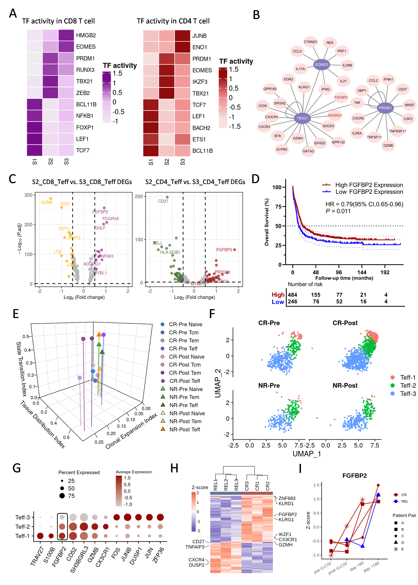

# Fig. 4 | Transcriptional programmes linked to effector-state remodelling and clinical response

> [Back to Repository Overview (EN)](../README.md) · [返回仓库首页 (中文)](../README.zh-CN.md)



[Download PDF](Combined/M04.pdf) · [Original EMF](Combined/M04.emf) · [External Cohorts & Data](../00_Global_Data/README.md)

## Key Findings

VIPER transcription factor activity inference and ARACNe regulon analysis show that progression from naive `State 1` (`TCF7`, `LEF1`, `FOXP1`, `BCL11B`) toward effector differentiation activates a **`TBX21`/`PRDM1`/`EOMES`-associated cytotoxic transcriptional program** regulating `PRF1`, `GZMH`, `ADGRG1`, and **`FGFBP2`** (`Fig. 4A–B`). Direct comparison of `S2_CD8_Teff` versus `S3_CD8_Teff` highlights strong enrichment of `FGFBP2`, `ADGRG1`, and `GNLY` in `S2_CD8_Teff`, whereas `S3_CD8_Teff` retains higher `GZMK` and `CD27` (`Fig. 4C`). Across public AML cohorts (Kaplan-Meier Plotter: TCGA and GEO), higher `FGFBP2` expression associates with improved overall survival (median OS 19.6 vs. 12.0 months; `HR = 0.79`, `P = 0.011`; `Fig. 4D`). Three independent post-allo-HSCT single-cell cohorts consistently link `FGFBP2`-high `CD8+` effector T cells to sustained complete remission (`CR`): expansion of an `FGFBP2+ S100B+` `Teff-1` subcluster in responders to salvage decitabine + ipilimumab (`GSE223844`, `Fig. 4E–G`), higher `FGFBP2` effector expression in CR versus early relapse bone marrow (`GSE216187`, `Fig. 4H`), and a pre-relapse dip at day +90 followed by post-DLI recovery in longitudinal donor–recipient pairs (`GSE222633`, `Fig. 4I`). Together, these findings support `FGFBP2` as a candidate marker associated with favorable post-transplant clinical outcomes.

## Panel Descriptions

- **(A)** VIPER-inferred transcription factor activity heatmaps across `CD8+` and `CD4+` differentiation states.
- **(B)** Gene regulatory network (GRN) of `TBX21`, `EOMES`, and `PRDM1` and their differentially expressed cytotoxic target genes.
- **(C)** Volcano plots comparing `S2` versus `S3` `Teff` cells in `CD8+` and `CD4+` lineages (`FGFBP2`, `ADGRG1`, `GNLY` vs. `GZMK`, `CD27`).
- **(D)** Kaplan-Meier overall survival analysis of AML cohorts stratified by `FGFBP2` expression (log-rank test).
- **(E–G)** Independent salvage immunotherapy cohort (`GSE223844`): 3D STARTRAC clonal summary (`E`), `CD8+ Teff` subcluster UMAP across `CR-Pre/Post` and `NR-Pre/Post` (`F`), and lineage marker dot plot (`G`).
- **(H)** Independent post-HSCT bone marrow cohort (`GSE216187`): Z-score heatmap of 16 differentially expressed effector markers comparing `CR` and `REL` patients.
- **(I)** Independent longitudinal allo-HSCT cohort (`GSE222633`): patient-level `FGFBP2` expression trajectories across donor–recipient pairs (`CR` vs. `REL`).

## Panel Directory

[A](a_M04a/README.md) · [B](b_M04b/README.md) · [C](c_M04c/README.md) · [D](d_M04d/README.md) · [E](e_M04e/README.md) · [F](f_M04f/README.md) · [G](g_M04g/README.md) · [H](h_M04h/README.md) · [I](i_M04i/README.md)

## Code, Inputs & Reproduction

- **Saved-table reproduction (verified directly from compact repository tables)**:
  ```bash
  # Fig. 4H (GSE216187 16-marker CR vs REL heatmap)
  python 00_Settings/run_saved_plot.py M04h --output /path/to/output_M04h

  # Fig. 4I (GSE222633 longitudinal CR vs REL trajectories)
  python 00_Settings/run_saved_plot.py M04i --output /path/to/output_M04i
  ```
- **Archived preprocessing & external cohort pipelines**: `00_Preprocess/GSE223844/`, `00_Preprocess/GSE216187_*/`, and `00_Preprocess/GSE222633_*/`.
- **Known source boundary**: Panel `Fig. 4D` was generated via the web-based Kaplan-Meier Plotter platform (TCGA + GSE12417/GSE37642/GSE6891); exact exported patient-level survival tables were not archived locally and the submitted panel image is retained.
