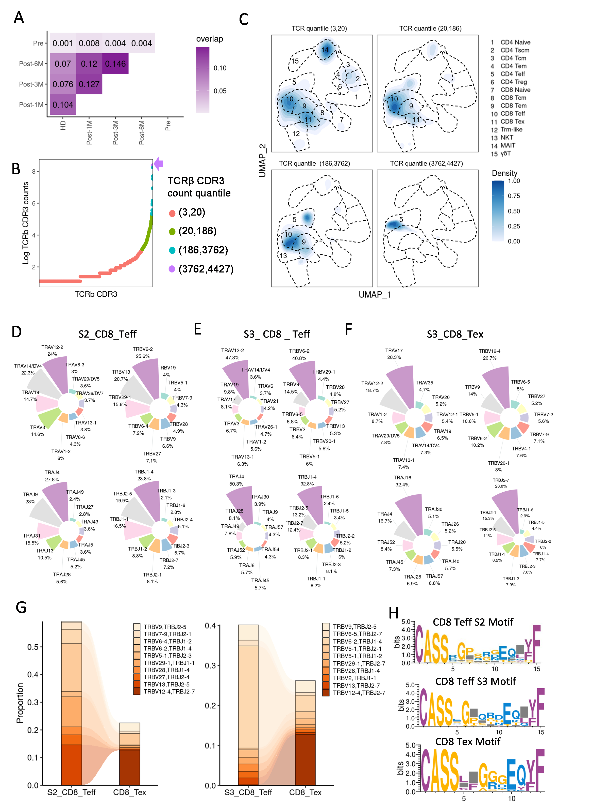

# Fig. 5 | Clonal architecture and T cell receptor convergence across CD8 effector states

> [Back to Repository Overview (EN)](../README.md) · [返回仓库首页 (中文)](../README.zh-CN.md)

[Download PDF](Combined/M05.pdf) · [Original EMF](Combined/M05.emf) · [Primary Shared Inputs](../00_Global_Data/Shared_Inputs/Primary/README.md)

## Key Findings

Longitudinal scTCR-seq comparison demonstrates extensive post-transplant clonal turnover: post-HSCT repertoires share substantially higher similarity with healthy donor (`HD`) repertoires than with recipients' `Pre-HSCT` baselines, reflecting reconstitution from donor-derived mature clones (`Fig. 5A`). Highly expanded TCRβ clonotypes (`N ≥ 3`) concentrate preferentially within `Teff` and `Tem` compartments (`Fig. 5B–C`). Across `CD8+` effector differentiation states, **`S2_CD8_Teff` retains broader V(D)J diversity**, whereas **`S3_CD8_Teff`** shows marked oligoclonal dominance (`TRAV12-2`, `TRBV6-2`, `TRAJ4`) (`Fig. 5D–F`). Alluvial connectivity and CDR3β sequence motif analyses reveal strong clonal continuity and central CDR3 homology (positions 7–11) between `S3_CD8_Teff` and terminally exhausted `CD8_Tex`, whereas dominant `S2_CD8_Teff` clones show limited transition into `CD8_Tex`, reinforcing the comparatively low-exhaustion profile of `S2_CD8_Teff` (`Fig. 5G–H`).

## Panel Descriptions

- **(A)** Pairwise TCRβ CDR3 repertoire overlap heatmap across `HD`, `Pre-HSCT`, and longitudinal post-HSCT time points.
- **(B)** Rank-abundance distribution of unique TCRβ CDR3 clonotypes stratified into four expansion quartiles.
- **(C)** Density projection of the four TCRβ clonal expansion quartiles onto the T cell UMAP embedding.
- **(D–F)** Donut charts of `TRAV`/`TRBV` and `TRAJ`/`TRBJ` gene segment usage in `S2_CD8_Teff` (`D`), `S3_CD8_Teff` (`E`), and `S3_CD8_Tex` (`F`).
- **(G)** Alluvial plots illustrating dominant `TRBV–TRBJ` sharing between `S2_CD8_Teff` and `CD8_Tex` (left) versus `S3_CD8_Teff` and `CD8_Tex` (right).
- **(H)** Enriched TCRβ CDR3 amino acid sequence logos across `S2_CD8_Teff`, `S3_CD8_Teff`, and `CD8_Tex`.

## Panel Directory

[A](a_M05a/README.md) · [B](b_M05b/README.md) · [C](c_M05c/README.md) · [D](d_M05d/README.md) · [E](e_M05e/README.md) · [F](f_M05f/README.md) · [G](g_M05g/README.md) · [H](h_M05h/README.md)

## Code, Inputs & Reproduction

- **Original archived scripts**: [02_TCR_gene_usage.R](01_Code/02_TCR_gene_usage.R), [03_state_specific_VJ_connectivity.R](01_Code/03_state_specific_VJ_connectivity.R), [01_STARTRAC_analysis.R](../Main_Figure_03/01_Code/01_STARTRAC_analysis.R), and archived CDR3 motif notes ([01_CDR3_motifs.source.txt](01_Code/01_CDR3_motifs.source.txt)).
- **Shared inputs**: Paired `CTgene`/`CTaa`/`Frequency`/`Celltype2` fields are exported in `00_Global_Data/Shared_Inputs/Primary/Tcell_metadata.csv.gz`; full V(D)J contigs remain in `/data5/tiany/HSCT/Result/final_vdj.rda` on server 252.
