# Dynamic T cell remodeling post-allogeneic hematopoietic stem cell transplantation reveals an FGFBP2-marked low-exhaustion effector T cell subset linking to sustained complete remission

<p align="center">
  <strong>Language / 语言</strong>: <strong>English</strong> &nbsp;|&nbsp; <a href="README.zh-CN.md">简体中文</a>
</p>

<p align="center">
  <a href="docs/manuscript/Manuscript-11.12.docx">Manuscript</a> &nbsp;·&nbsp;
  <a href="docs/manuscript/Supplementary_Figures-11.12.docx">Supplementary Figures</a> &nbsp;·&nbsp;
  <a href="docs/manuscript/Responses-11.12.pdf">Reviewer Responses</a> &nbsp;·&nbsp;
  <a href="00_Settings/00_Panel_Code_Index.tsv">Panel Index (71 panels)</a> &nbsp;·&nbsp;
  <a href="00_Settings/GLOBAL_PALETTE.md">Locked Palettes</a> &nbsp;·&nbsp;
  <a href="00_Global_Data/README.md">Data &amp; Cohorts</a>
</p>

---

**Authors**: Yun Tian<sup>1,2,3#</sup>, Yikai Zhang<sup>1,2,4</sup>, Jiamian Zheng<sup>1,2</sup>, Bo Yu<sup>5</sup>, Yueyi Sun<sup>1</sup>, Shaohua Chen<sup>1</sup>, Liye Zhong<sup>2</sup>, Xianfeng Zha<sup>6*</sup>, Jie Chen<sup>2*</sup>, Oscar Junhong Luo<sup>3*</sup>, Yangqiu Li<sup>1,2*</sup>

**Affiliations**:
1. Institute of Hematology, School of Medicine, Jinan University, Guangzhou 510632, China
2. Department of Hematology, First Affiliated Hospital of Jinan University, Guangzhou 510632, China
3. Department of Systems Biomedical Sciences, School of Medicine, Jinan University, Guangzhou 510632, China
4. Experimental Teaching Center of Functional Science of Basic Medicine, School of Medicine, Jinan University, Guangzhou 510632, China
5. Medical Experiment Research Center, School of Medicine, Jinan University, Guangzhou 510632, China
6. Department of Clinical Laboratory, First Affiliated Hospital of Jinan University, Guangzhou 510632, China

**Correspondence**: `yangqiuli@hotmail.com` · `luojh@jnu.edu.cn` · `little2244@163.com` · `zhaxianfeng_0@163.com`

---

## Study Overview

Relapse has surpassed non-relapse mortality as the leading cause of treatment failure in acute myeloid leukemia (AML) after allogeneic hematopoietic stem cell transplantation (allo-HSCT). While donor-derived graft-versus-leukemia (GVL) immunity underpins durable remission, the longitudinal transcriptional states and clonal trajectories governing effective versus exhausted post-transplant T cell reconstitution remain incompletely defined.

To resolve this process, we integrated paired single-cell RNA sequencing (scRNA-seq) and single-cell T cell receptor sequencing (scTCR-seq) across a longitudinal discovery cohort of **23 peripheral blood mononuclear cell (PBMC) samples** from five AML patients (pre-conditioning and 1, 3, and 6 months post-allo-HSCT) and their paired pre-mobilization healthy donors (HD), capturing **175,531 PBMCs** and **72,884 T cells** across 15 subsets. Findings were validated across three independent post-allo-HSCT single-cell cohorts (`GSE223844`, `GSE216187`, `GSE222633`) and multi-cohort AML survival datasets (TCGA and GEO).

### Key Findings

1. **Qualitative divergence beyond numerical recovery**: Early reconstitution (`Post-1M`) is marked by transient myeloid dominance, naive T cell depletion, functional hyperactivation, and severe TCR repertoire contraction; although total T cell counts approach donor levels by month 6, T cell transcriptional states and clonal diversity remain fundamentally remodeled (`Fig. 1`, `Fig. 2`).
2. **Bifurcated CD8<sup>+</sup> differentiation architecture**: Rather than following a linear path to exhaustion, post-transplant CD8<sup>+</sup> T cells bifurcate into a cytotoxic effector branch (`State 2`, dominated by `S2_CD8_Teff`) and an exhaustion-prone branch (`State 3`, linking `S3_CD8_Teff` to terminally exhausted `CD8_Tex`), with `S2_CD8_Teff` displaying the highest STARTRAC tumor-reactive clonal profile (`Fig. 3`).
3. **A TBX21-associated `FGFBP2`<sup>+</sup> effector signature linked to sustained remission**: `S2_CD8_Teff` is governed by a `TBX21`-associated cytotoxic program marked by `FGFBP2` and `ADGRG1`. Across independent AML cohorts, elevated `FGFBP2` expression associates with improved overall survival and sustained complete remission (`CR`) versus relapse/non-response (`REL`/`NR`) (`Fig. 4`).
4. **Low-exhaustion clonal stability of `S2_CD8_Teff`**: Compared with `S3_CD8_Teff`, `S2_CD8_Teff` maintains broader V(D)J diversity, lower inhibitory receptor positivity, and limited clonal transition into `CD8_Tex`, supporting its potential as a candidate cellular and molecular signature for post-transplant immune monitoring (`Fig. 5`, `Fig. S6`).

---

## Multi-Cohort Study Architecture

| Cohort | Accession / Source | Clinical Context & Design | Assay & Scope | Role in Study |
|---|---|---|---|---|
| **Primary Discovery** | [GSA-Human: PRJCA067718](https://ngdc.cncb.ac.cn/gsa-human/) | 5 AML recipients + 5 paired HDs (`HD`, `Pre-HSCT`, `Post-1M`, `Post-3M`, `Post-6M`; 23 PBMC samples) | 10x 5′ scRNA-seq + scTCR-seq (175,531 PBMCs; 72,884 T cells) | Atlas, trajectory, TF network, TCR architecture (`Fig. 1–5`, `Fig. S1–S3`, `S6`) |
| **Salvage Immunotherapy** | [GEO: GSE223844](https://www.ncbi.nlm.nih.gov/geo/query/acc.cgi?acc=GSE223844) | 8 relapsed post-allo-HSCT AML patients treated with decitabine + ipilimumab (3 CR, 5 NR; bone marrow) | Paired scRNA-seq + scTCR-seq | Validation of `FGFBP2`<sup>+</sup> `Teff-1` expansion in CR (`Fig. 4E–G`, `Fig. S4`) |
| **Day +100 Post-HSCT** | [GEO: GSE216187](https://www.ncbi.nlm.nih.gov/geo/query/acc.cgi?acc=GSE216187) | 6 AML recipients sampled ~day +100 post-allo-HSCT (3 CR, 3 early REL; bone marrow) | scRNA-seq | Transcriptional similarity to `S2_CD8_Teff` and CR vs REL DE (`Fig. 4H`, `Fig. S5A–D`) |
| **Longitudinal Pairs** | [GEO: GSE222633](https://www.ncbi.nlm.nih.gov/geo/query/acc.cgi?acc=GSE222633) | 5 donor–recipient allo-HSCT pairs (Pre/Post G-CSF, day +90, day +180; 4 CR, 1 REL with DLI) | Longitudinal scRNA-seq + scTCR-seq | Pre-relapse `FGFBP2` decline & post-DLI recovery (`Fig. 4I`, `Fig. S5E–G`) |
| **Bulk Survival** | TCGA + GEO (`GSE12417`, `GSE37642`, `GSE6891`) | Multi-cohort AML overall survival stratified by `FGFBP2` expression (Kaplan-Meier Plotter) | Bulk transcriptomics | Prognostic association with overall survival (`Fig. 4D`) |

---

## Main Figures & Key Results

### Fig. 1 | Longitudinal single-cell atlas of peripheral blood immune reconstitution post-allo-HSCT

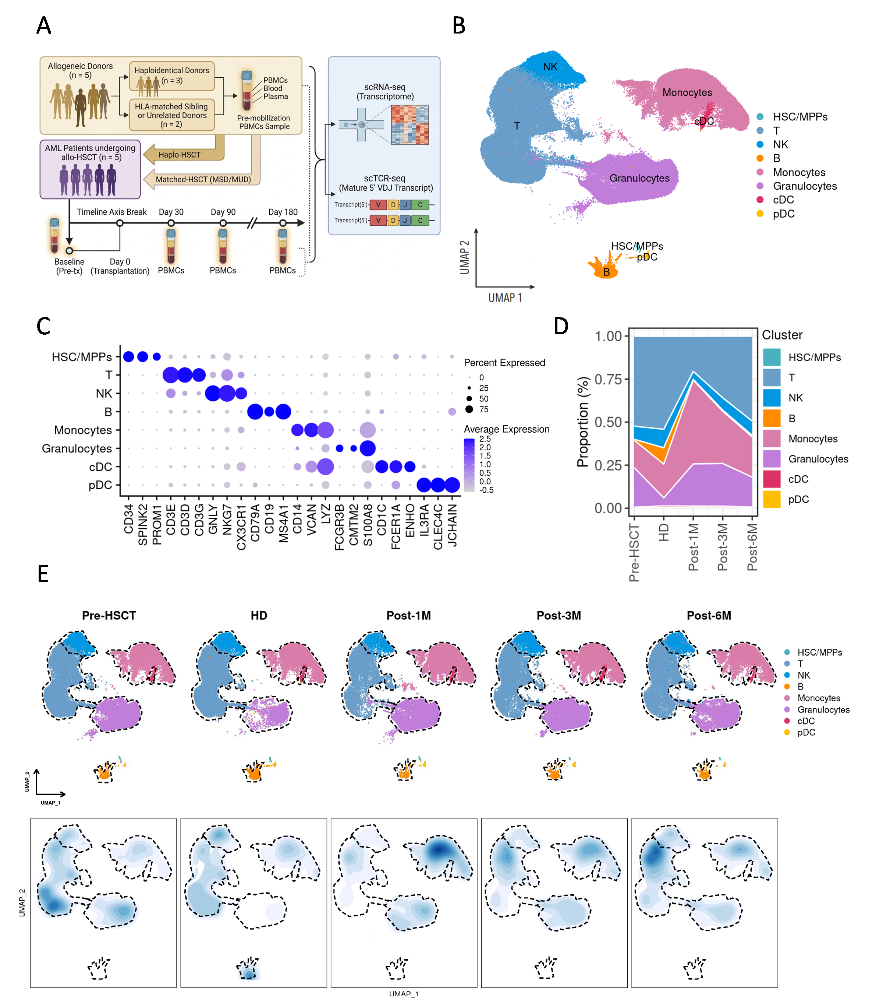

[PDF](Main_Figure_01/Combined/M01.pdf) · [Original EMF](Main_Figure_01/Combined/M01.emf) · [Detailed Results, Code & Data](Main_Figure_01/README.md)

Integrated profiling of 23 longitudinal PBMC samples resolves nine major hematopoietic lineages (`Fig. 1A–C`). Early post-transplant reconstitution (`Post-1M`) shifts sharply toward myeloid cells with profound T cell contraction (`Fig. 1D`). Although T cell abundance gradually rebounds by months 3–6 to approach healthy donor levels, spatial density distributions remain clearly displaced from HD and Pre-HSCT baselines (`Fig. 1E`), indicating persistent qualitative remodeling of the reconstituting T cell pool.

### Fig. 2 | Remodelling of T cell functional states and the TCR repertoire post-allo-HSCT

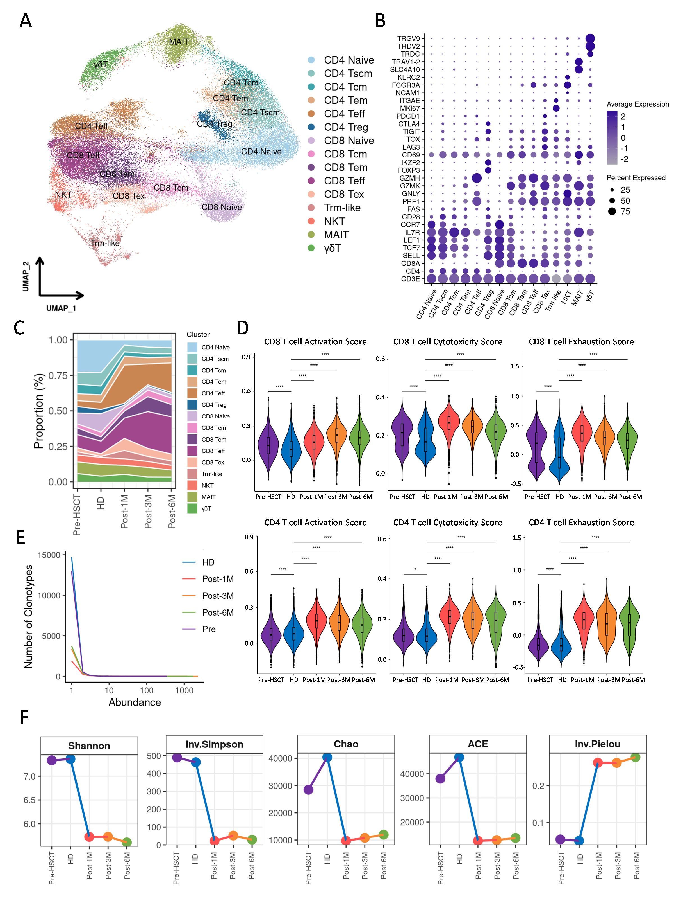

[PDF](Main_Figure_02/Combined/M02.pdf) · [Original EMF](Main_Figure_02/Combined/M02.emf) · [Detailed Results, Code & Data](Main_Figure_02/README.md)

Re-clustering of the T cell compartment identifies 15 transcriptional states spanning naive, memory, cytotoxic effector, exhausted, regulatory, and unconventional lineages (`Fig. 2A–B`). Post-transplant recovery is skewed away from naive compartments toward cytotoxic `CD8+ Teff` and `CD8+ Tex` subsets (`Fig. 2C`), accompanied by elevated activation, cytotoxicity, and exhaustion scores peaking at `Post-1M` (`Fig. 2D`). Paired scTCR-seq reveals persistent repertoire contraction and reduced clonal diversity across all five diversity metrics through month 6 (`Fig. 2E–F`).

### Fig. 3 | Trajectory analysis identifies distinct state transitions in CD8 and CD4 T cells

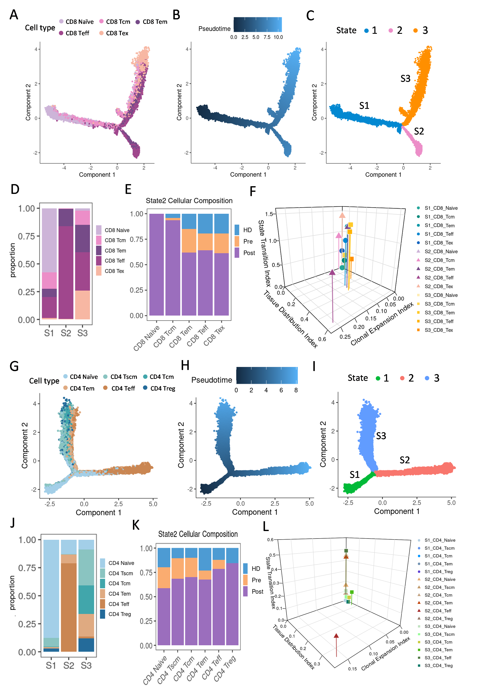

[PDF](Main_Figure_03/Combined/M03.pdf) · [Original EMF](Main_Figure_03/Combined/M03.emf) · [Detailed Results, Code & Data](Main_Figure_03/README.md)

Pseudotime reconstruction demonstrates that post-transplant `CD8+` T cells bifurcate from a donor-enriched naive root (`State 1`) into a cytotoxic effector branch (`State 2`, enriched for `S2_CD8_Teff`) and an exhaustion-prone branch (`State 3`, clustering `CD8+ Tex` with `S3_CD8_Teff`) (`Fig. 3A–E`). Integrated STARTRAC clonal metrics pinpoint `S2_CD8_Teff` as the compartment with the strongest putative tumor-reactive profile (`Fig. 3F`). `CD4+` T cells exhibit an analogous bifurcation into a post-transplant effector branch (`State 2`) and a memory/regulatory branch (`State 3`) with lower clonal expansion reactivity (`Fig. 3G–L`).

### Fig. 4 | Transcriptional programmes linked to effector-state remodelling and clinical response

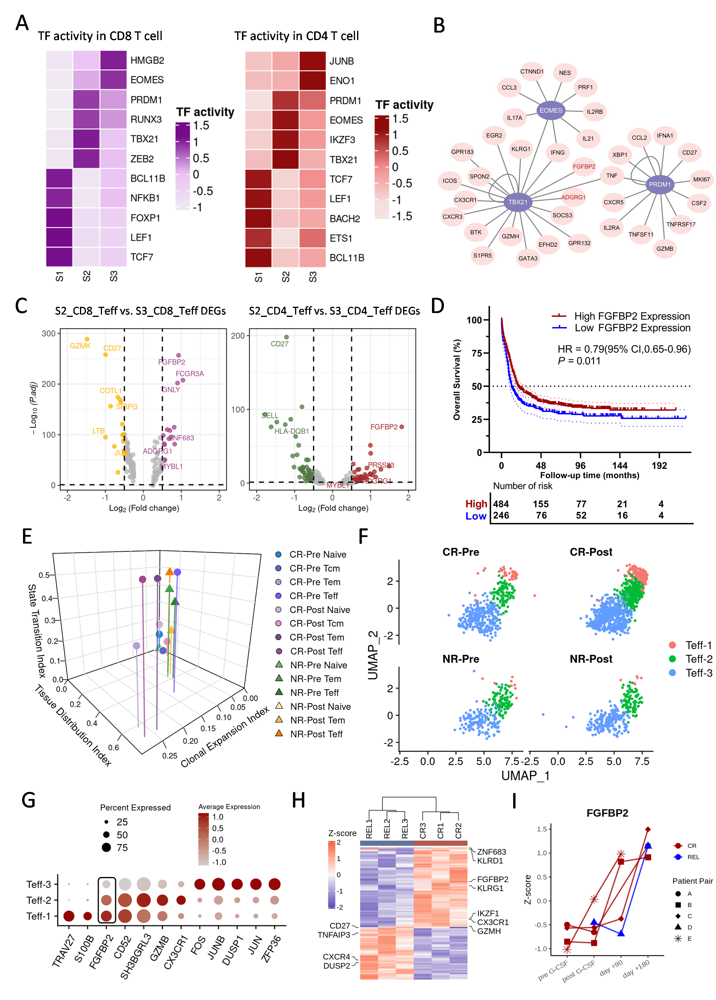

[PDF](Main_Figure_04/Combined/M04.pdf) · [Original EMF](Main_Figure_04/Combined/M04.emf) · [Detailed Results, Code & Data](Main_Figure_04/README.md)

Transcription factor activity inference and regulatory network reconstruction link effector differentiation to a `TBX21`/`PRDM1`/`EOMES`-associated cytotoxic program driving `FGFBP2`, `ADGRG1`, `PRF1`, and `GZMH`, clearly distinguishing `S2_CD8_Teff` from `GZMK`/`CD27`-enriched `S3_CD8_Teff` (`Fig. 4A–C`). Higher `FGFBP2` expression associates with improved overall survival in public AML cohorts (`Fig. 4D`) and consistently aligns with sustained complete remission across three independent post-allo-HSCT single-cell cohorts: `FGFBP2+ Teff-1` expansion in responders (`GSE223844`, `Fig. 4E–G`), elevated effector `FGFBP2` in CR versus early relapse (`GSE216187`, `Fig. 4H`), and pre-relapse reduction followed by post-DLI recovery (`GSE222633`, `Fig. 4I`). These multi-cohort findings support clinical association rather than direct causal proof.

### Fig. 5 | Clonal architecture and T cell receptor convergence across CD8 effector states

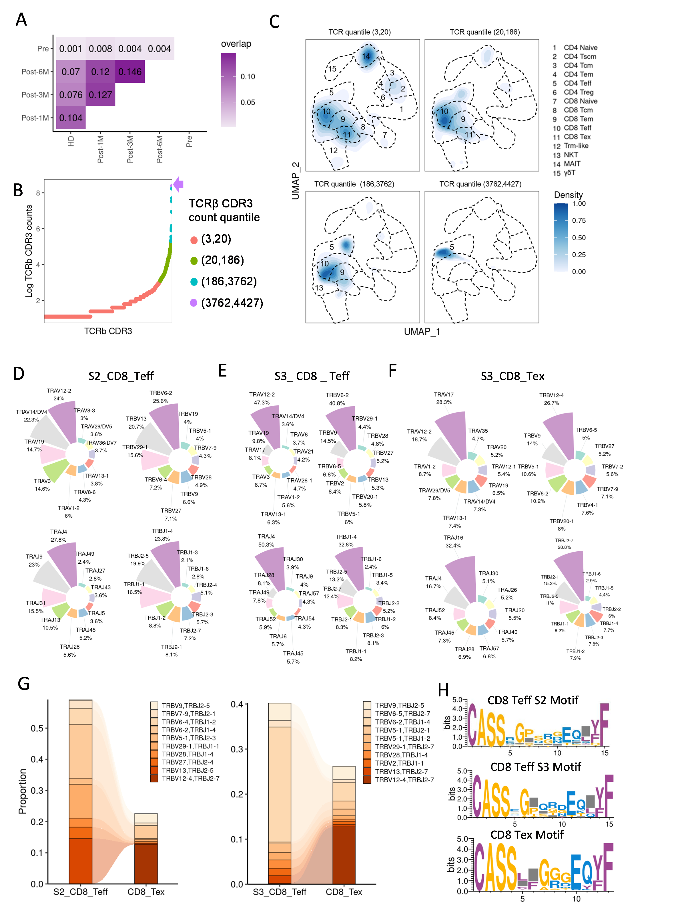

[PDF](Main_Figure_05/Combined/M05.pdf) · [Original EMF](Main_Figure_05/Combined/M05.emf) · [Detailed Results, Code & Data](Main_Figure_05/README.md)

Post-transplant TCR repertoires closely resemble donor (`HD`) rather than recipient `Pre-HSCT` baselines, with highly expanded clonotypes localizing predominantly to `Teff` and `Tem` clusters (`Fig. 5A–C`). Whereas `S3_CD8_Teff` exhibits pronounced oligoclonal dominance and extensive V(D)J sharing and central CDR3β motif homology with `CD8_Tex`, `S2_CD8_Teff` maintains broader receptor diversity and limited clonal transition toward exhaustion (`Fig. 5D–H`).

---

## Supplementary Figures

| Figure | Title | Links |
|---|---|---|
| **Fig. S1** | Overview of sample distribution and immune lineage composition following HSCT | [PNG](Supplementary_Figures/Supplementary_Figure_01/Combined/S01.png) · [PDF](Supplementary_Figures/Supplementary_Figure_01/Combined/S01.pdf) · [Details](Supplementary_Figures/Supplementary_Figure_01/README.md) |
| **Fig. S2** | Dynamic changes in T cell composition and spatial distribution post-allo-HSCT | [PNG](Supplementary_Figures/Supplementary_Figure_02/Combined/S02.png) · [PDF](Supplementary_Figures/Supplementary_Figure_02/Combined/S02.pdf) · [Details](Supplementary_Figures/Supplementary_Figure_02/README.md) |
| **Fig. S3** | Compositional analysis of T cell developmental states and external validation of transcriptomic signatures | [PNG](Supplementary_Figures/Supplementary_Figure_03/Combined/S03.png) · [PDF](Supplementary_Figures/Supplementary_Figure_03/Combined/S03.pdf) · [Details](Supplementary_Figures/Supplementary_Figure_03/README.md) |
| **Fig. S4** | T cell landscape and enrichment analysis in the independent clinical validation cohort (`GSE223844`) | [PNG](Supplementary_Figures/Supplementary_Figure_04/Combined/S04.png) · [PDF](Supplementary_Figures/Supplementary_Figure_04/Combined/S04.pdf) · [Details](Supplementary_Figures/Supplementary_Figure_04/README.md) |
| **Fig. S5** | Independent validation of the FGFBP2-associated effector T cell phenotype in AML allo-HSCT cohorts (`GSE216187`, `GSE222633`) | [PNG](Supplementary_Figures/Supplementary_Figure_05/Combined/S05.png) · [PDF](Supplementary_Figures/Supplementary_Figure_05/Combined/S05.pdf) · [Details](Supplementary_Figures/Supplementary_Figure_05/README.md) |
| **Fig. S6** | Clonal lineage connectivity and expression profiles of immune checkpoints across T cell states | [PNG](Supplementary_Figures/Supplementary_Figure_06/Combined/S06.png) · [PDF](Supplementary_Figures/Supplementary_Figure_06/Combined/S06.pdf) · [Details](Supplementary_Figures/Supplementary_Figure_06/README.md) |

<details>
<summary><strong>Preview all Supplementary Figures inline (click to expand)</strong></summary>

#### Supplementary Figure 1
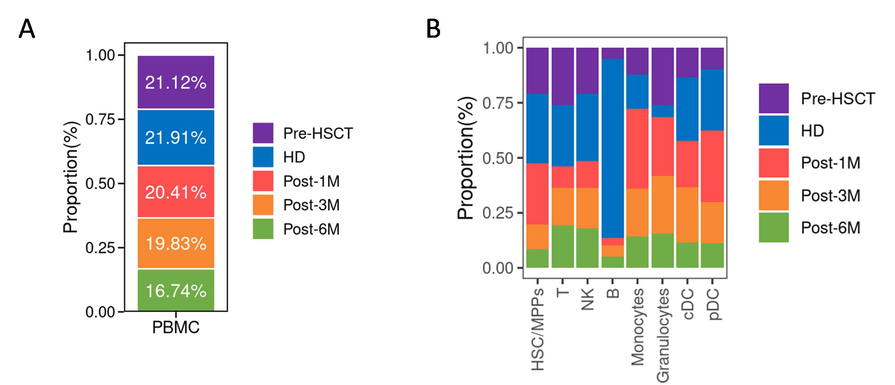

#### Supplementary Figure 2
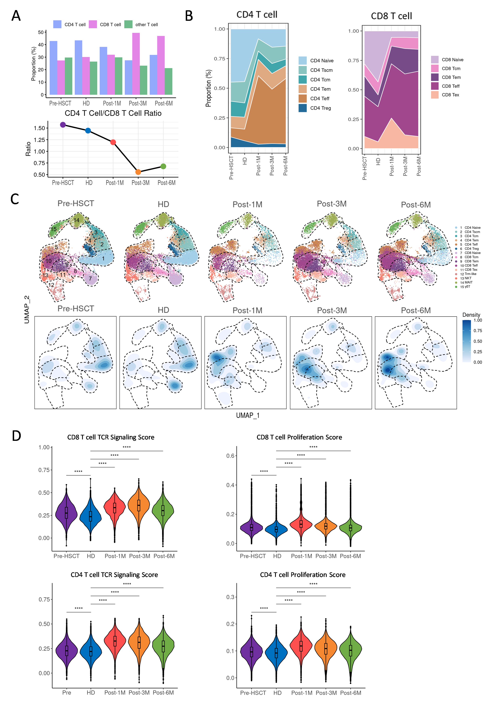

#### Supplementary Figure 3
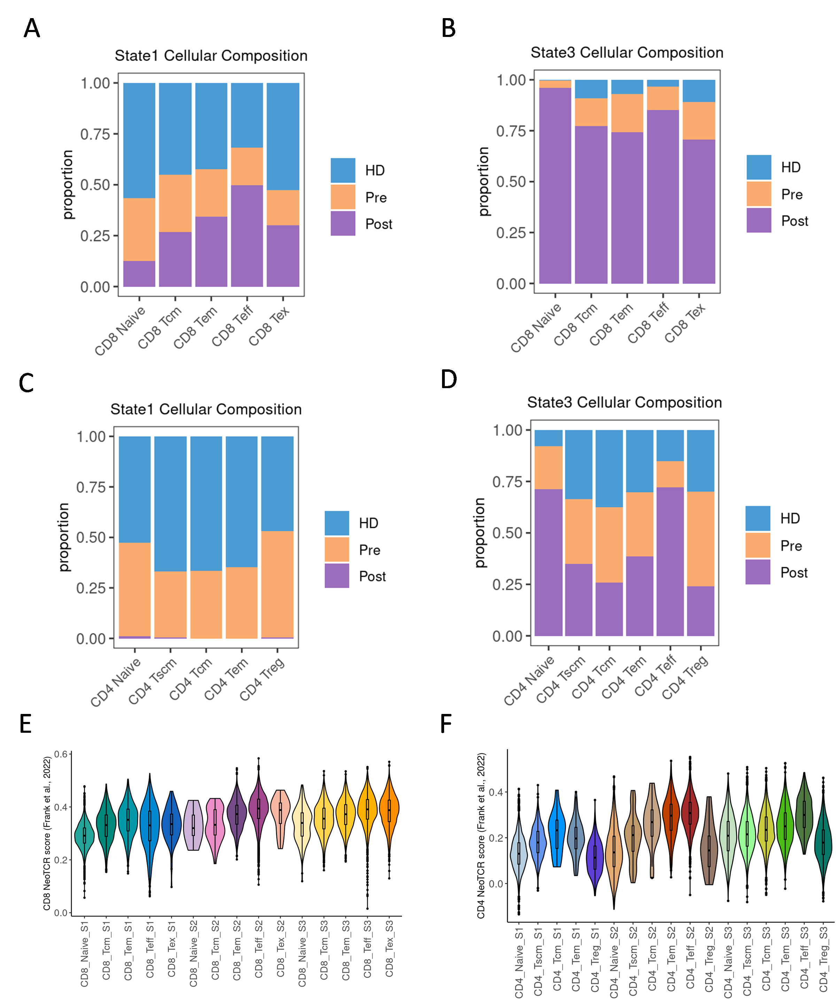

#### Supplementary Figure 4
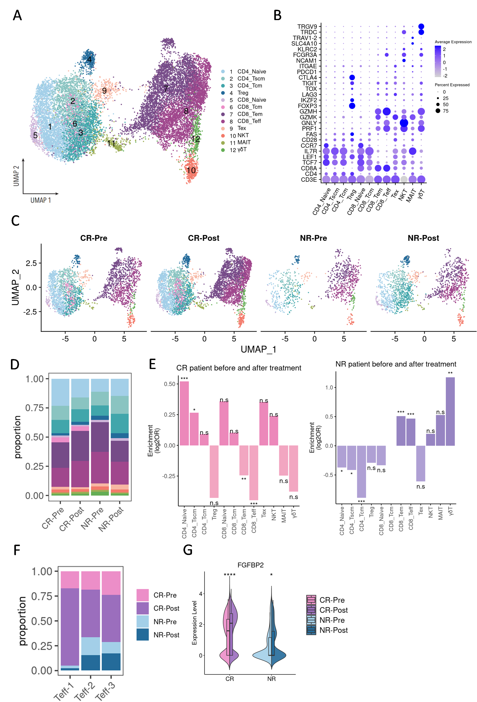

#### Supplementary Figure 5
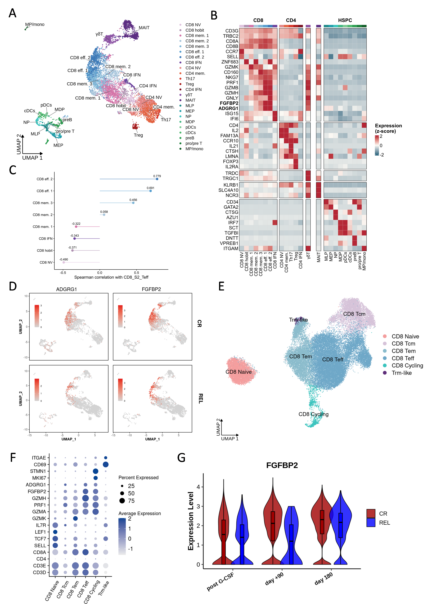

#### Supplementary Figure 6
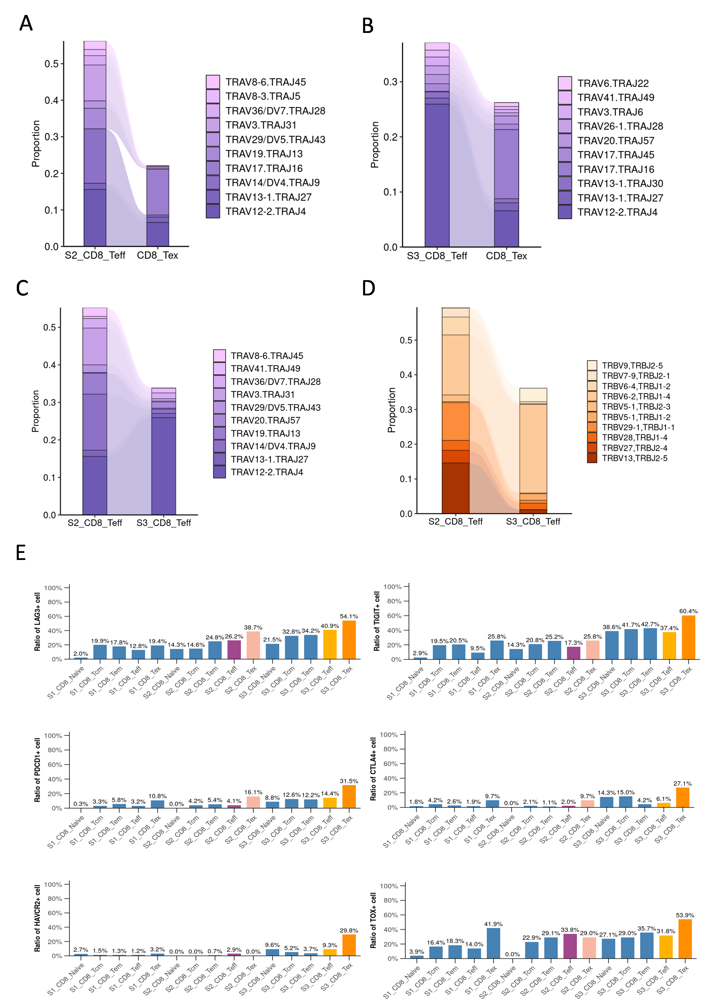

</details>

---

## Repository Organization & Reproducibility

```text
Project-tianyun-HSCT-FGFBP2/
├── README.md                              # English paper-style repository overview
├── README.zh-CN.md                        # 简体中文论文式仓库说明
├── docs/manuscript/                       # Submitted manuscript, supplementary figures, and responses
├── 00_Settings/                           # Panel index, locked palettes, portable runner, R sessionInfo
│   ├── 00_Panel_Code_Index.tsv            # Master 71-panel provenance & script index
│   ├── 00_External_Data_Dependencies.tsv  # Multi-GB server RDS objects & public GEO accessions
│   ├── GLOBAL_PALETTE.md                  # Locked HEX palettes (machine-readable: global_palette.tsv)
│   ├── 03_reproduce_primary_panels.R      # Portable primary-cohort verification script (no RDS needed)
│   └── run_saved_plot.py                  # Unified CLI to reproduce saved-table panels in a clean folder
├── 00_Global_Data/Shared_Inputs/          # Compact exported metadata, embeddings, expression & plot tables
├── Main_Figure_01/ .. Main_Figure_05/     # Combined EMF/PNG/PDF, panel directories, archived scripts
└── Supplementary_Figures/                 # Supplementary_Figure_01 .. 06 (Combined + panel directories)
```

### Quick Start: Reproducing Panels from Compact Saved Tables

All saved-table jobs execute directly from compact tables bundled in this repository (no multi-gigabyte Seurat `.rds` objects required). Requirements: **Python ≥ 3.8** and **R (≥ 4.1.0)** with `data.table`, `ggplot2`, `scales`, `ggrepel`, `ComplexHeatmap`, `circlize`, and `jsonlite` (see [R_sessionInfo.txt](00_Settings/R_sessionInfo.txt)).

```bash
# 1. List all verified saved-table reproduction jobs
python 00_Settings/run_saved_plot.py --list

# 2. Reproduce primary-cohort panels (Fig. 1-3, S1-S3, S6E) directly from exported tables
python 00_Settings/run_saved_plot.py primary_all --output /path/to/repro_primary

# 3. Reproduce external validation cohort panels (Fig. 4H, 4I, S5B, S5C, S5E-G)
python 00_Settings/run_saved_plot.py M04h  --output /path/to/repro_M04h
python 00_Settings/run_saved_plot.py M04i  --output /path/to/repro_M04i
python 00_Settings/run_saved_plot.py S05b  --output /path/to/repro_S05b
python 00_Settings/run_saved_plot.py S05c  --output /path/to/repro_S05c
python 00_Settings/run_saved_plot.py S05ef --output /path/to/repro_S05ef
python 00_Settings/run_saved_plot.py S05f  --output /path/to/repro_S05f
python 00_Settings/run_saved_plot.py S05g  --output /path/to/repro_S05g
```

To regenerate compact primary inputs from the original fitted Seurat/Monocle objects on the compute server without refitting:

```bash
Rscript 00_Settings/01_export_Tcell_plot_inputs.R /path/to/HSCT/Result /path/to/exported_inputs
Rscript 00_Settings/02_export_PBMC_plot_inputs.R  /path/to/HSCT/Result /path/to/exported_inputs
```

### Provenance & Scope Disclosure for Reviewers

- **Submitted manuscript figures**: All 11 composite figures in `Combined/` (`M01–M05`, `S01–S06`) preserve the exact submitted EMF files together with PNG/PDF renderings; no scientific results were refitted or altered.
- **Large objects**: Multi-gigabyte Seurat/Monocle `.rds` and `.rda` files are not tracked in Git; exact paths, byte sizes, and public GEO links are documented in [00_External_Data_Dependencies.tsv](00_Settings/00_External_Data_Dependencies.tsv).
- **Known archived source gaps**: Detailed transparently in [00_Settings/README.md](00_Settings/README.md) — specifically the editable design file for schematic `Fig. 1A`, patient-level survival export behind the web-based Kaplan-Meier Plotter panel `Fig. 4D`, the `NeoTCR` scoring column/script for `Fig. S3E–F`, and archived `.source.txt` interactive fragments requiring full session objects.

---

## Data Availability, Ethics & Funding

- **Data availability**: Raw and processed scRNA-seq and paired scTCR-seq data from the discovery cohort are deposited in the Genome Sequence Archive for Human (GSA-Human, NGDC/CNCB) under controlled-access accession **`PRJCA067718`**. Independent validation datasets are publicly available at GEO under accessions **`GSE223844`**, **`GSE216187`**, and **`GSE222633`**.
- **Ethics**: Approved by the Ethics Committee of the First Affiliated Hospital of Jinan University (Approval Nos. `20220915` and `JNUECKY-20251205-012`) in accordance with the Declaration of Helsinki; written informed consent was obtained from all participants.
- **Funding**: Supported by the National Natural Science Foundation of China (Grant Nos. `82293632`, `82293630`, `92370107`, `82400259`; Major Program Subproject No. `21322312`), Fundamental Research Funds for the Central Universities (`21623121`, `21625219`), Guangzhou Science and Technology Project (`202102070001`), National College Students' Innovation and Entrepreneurship Training Program (`202610559052`), and the K. C. Wong Education Foundation.

## Citation

If you use the datasets, annotations, or analysis workflows in this repository, please cite:

> Tian Y, Zhang Y, Zheng J, Yu B, Sun Y, Chen S, Zhong L, Zha X, Chen J, Luo OJ, Li Y. *Dynamic T cell remodeling post-allogeneic hematopoietic stem cell transplantation reveals an FGFBP2-marked low-exhaustion effector T cell subset linking to sustained complete remission.* (Manuscript, Jinan University).
