# 异基因造血干细胞移植后动态 T 细胞重塑揭示与持续完全缓解相关的 FGFBP2<sup>+</sup> 低耗竭效应 T 细胞亚群

<p align="center">
  <strong>语言 / Language</strong>: <a href="README.md">English</a> &nbsp;|&nbsp; <strong>简体中文</strong>
</p>

<p align="center">
  <a href="docs/manuscript/Manuscript-11.12.docx">论文手稿</a> &nbsp;·&nbsp;
  <a href="docs/manuscript/Supplementary_Figures-11.12.docx">补充图件</a> &nbsp;·&nbsp;
  <a href="docs/manuscript/Responses-11.12.pdf">审稿回复</a> &nbsp;·&nbsp;
  <a href="00_Settings/00_Panel_Code_Index.tsv">分图代码总索引（71 个分图）</a> &nbsp;·&nbsp;
  <a href="00_Settings/GLOBAL_PALETTE.md">全局锁定配色</a> &nbsp;·&nbsp;
  <a href="00_Global_Data/README.md">数据与队列说明</a>
</p>

---

**英文题名**：*Dynamic T cell remodeling post-allogeneic hematopoietic stem cell transplantation reveals an FGFBP2-marked low-exhaustion effector T cell subset linking to sustained complete remission*

**作者**：田云（Yun Tian）<sup>1,2,3#</sup>、张一凯（Yikai Zhang）<sup>1,2,4</sup>、郑佳勉（Jiamian Zheng）<sup>1,2</sup>、于博（Bo Yu）<sup>5</sup>、孙悦艺（Yueyi Sun）<sup>1</sup>、陈少华（Shaohua Chen）<sup>1</sup>、钟立业（Liye Zhong）<sup>2</sup>、查显丰（Xianfeng Zha）<sup>6*</sup>、陈洁（Jie Chen）<sup>2*</sup>、罗钧洪（Oscar Junhong Luo）<sup>3*</sup>、李扬秋（Yangqiu Li）<sup>1,2*</sup>

**单位**：
1. 暨南大学医学院血液学研究所（生物活性分子与成药性评估国家重点实验室 / 广东省基础研究卓越中心 / 教育部再生医学重点实验室），广州 510632
2. 暨南大学附属第一医院血液内科，广州 510632
3. 暨南大学医学院系统生物医学系，广州 510632
4. 暨南大学医学院基础医学机能实验教学中心，广州 510632
5. 暨南大学医学院医学实验研究中心，广州 510632
6. 暨南大学附属第一医院检验科，广州 510632

**通讯作者**：`yangqiuli@hotmail.com` · `luojh@jnu.edu.cn` · `little2244@163.com` · `zhaxianfeng_0@163.com`

---

## 研究背景与核心发现

复发已超过非复发死亡，成为急性髓系白血病（AML）患者接受异基因造血干细胞移植（allo-HSCT）后治疗失败的首要原因。尽管供者来源的移植物抗白血病（GVL）效应是维持长期缓解的关键基础，但移植后外周血 T 细胞重建过程中的转录状态演进与克隆演化规律仍未系统阐明。

本研究整合纵向单细胞转录组测序（scRNA-seq）与配对单细胞 T 细胞受体测序（scTCR-seq），系统追踪了 5 例 AML 患者（预处理前及移植后 1、3、6 个月）及其配对健康供者（动员前）共 **23 份外周血单个核细胞（PBMC）样本**，获得 **175,531 个高质量 PBMC 细胞**与 **72,884 个 T 细胞**（15 个精细亚群），并在三个独立 allo-HSCT 单细胞队列（`GSE223844`、`GSE216187`、`GSE222633`）及公共 AML 生存队列（TCGA 与 GEO）中验证了核心发现。

### 主要科学发现

1. **数量恢复之外的质性重塑**：移植后早期（`Post-1M`）表现为髓系一过性占优、T 细胞急剧缩减、功能过度激活及 TCR 多样性骤降；尽管移植后 6 个月 T 细胞总数接近健康供者水平，但其亚群结构与克隆多样性仍处于持续重塑状态（`Fig. 1`、`Fig. 2`）。
2. **CD8<sup>+</sup> T 细胞的分叉分化格局**：移植后 CD8<sup>+</sup> T 细胞并非单向线性走向耗竭，而是从供者富集的初始根态（`State 1`）分叉进入两条终末轨迹——高效应细胞毒性分支（`State 2`，以 `S2_CD8_Teff` 为主）与耗竭倾向分支（`State 3`，聚集 `S3_CD8_Teff` 与终末耗竭 `CD8_Tex`）；综合 STARTRAC 克隆扩增、迁移与状态转换指标，`S2_CD8_Teff` 展现出最强的候选抗白血病反应特征（`Fig. 3`）。
3. **TBX21 相关的 `FGFBP2`<sup>+</sup> 效应程序与持续完全缓解相关**：`S2_CD8_Teff` 由 `TBX21` 相关细胞毒性转录程序驱动，特异性高表达 `FGFBP2` 与 `ADGRG1`。在多个独立 AML 队列中，较高水平的 `FGFBP2` 表达与更优总生存期及移植后持续完全缓解（`CR`）一致相关（`Fig. 4`）。
4. **`S2_CD8_Teff` 保持低耗竭克隆稳态**：相较于与 `CD8_Tex` 具有高度克隆连续性及 CDR3 同源性的 `S3_CD8_Teff`，`S2_CD8_Teff` 维持更宽的 V(D)J 多样性、更低的免疫检查点阳性率以及有限的向耗竭终态迁移倾向，提示其可作为移植后免疫监测的候选细胞与分子标志（`Fig. 5`、`Fig. S6`）。

---

## 多队列研究设计总览

| 队列 | 数据编号 / 来源 | 临床背景与采样设计 | 测序类型与规模 | 本研究用途 |
|---|---|---|---|---|
| **主发现队列** | [GSA-Human: PRJCA067718](https://ngdc.cncb.ac.cn/gsa-human/) | 5 例 AML 受者 + 5 例配对供者（`HD`、`Pre-HSCT`、`Post-1M/3M/6M`，共 23 份 PBMC） | 10x 5′ scRNA-seq + scTCR-seq（175,531 PBMC；72,884 T 细胞） | 全景图谱、分化轨迹、调控网络与克隆结构（`Fig. 1–5`、`Fig. S1–S3, S6`） |
| **挽救免疫治疗验证队列** | [GEO: GSE223844](https://www.ncbi.nlm.nih.gov/geo/query/acc.cgi?acc=GSE223844) | 8 例 allo-HSCT 后复发 AML 患者（地西他滨 + 伊匹木单抗治疗前后；3 CR, 5 NR；骨髓） | 配对 scRNA-seq + scTCR-seq | 验证 CR 组 `FGFBP2`<sup>+</sup> `Teff-1` 特异性扩增（`Fig. 4E–G`、`Fig. S4`） |
| **移植后 +100 天骨髓队列** | [GEO: GSE216187](https://www.ncbi.nlm.nih.gov/geo/query/acc.cgi?acc=GSE216187) | 6 例 allo-HSCT 后约 +100 天 AML 患者骨髓样本（3 CR, 3 早期复发 REL） | scRNA-seq | 验证与 `S2_CD8_Teff` 的转录相似性及 CR vs REL 差异表达（`Fig. 4H`、`Fig. S5A–D`） |
| **纵向供受者配对队列** | [GEO: GSE222633](https://www.ncbi.nlm.nih.gov/geo/query/acc.cgi?acc=GSE222633) | 5 对供受者配对样本（G-CSF 动员前后及移植后 +90/+180 天；4 CR, 1 例复发并接受 DLI） | 纵向 scRNA-seq + scTCR-seq | 验证复发前 +90 天 `FGFBP2` 下降及 DLI 后回升（`Fig. 4I`、`Fig. S5E–G`） |
| **公共生存分析队列** | TCGA + GEO（`GSE12417`、`GSE37642`、`GSE6891`） | 基于 Kaplan-Meier Plotter 平台的 AML 患者总生存期分层 | Bulk 转录组 | 评估 `FGFBP2` 表达与 AML 总生存期的预后关联（`Fig. 4D`） |

---

## 主图与核心结果展示

### Fig. 1 | 异基因造血干细胞移植后外周血免疫重建的纵向单细胞图谱

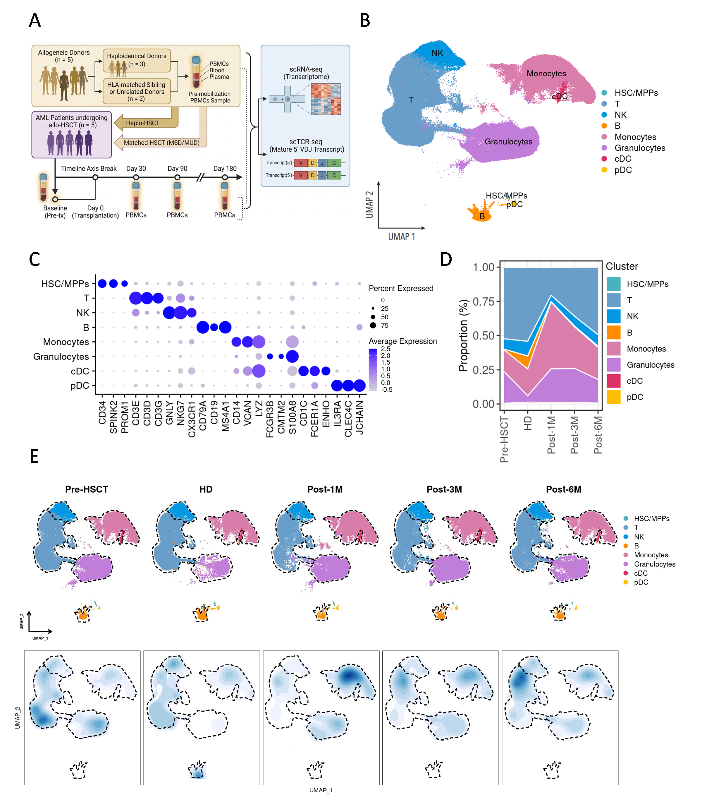

[下载 PDF](Main_Figure_01/Combined/M01.pdf) · [原始 EMF](Main_Figure_01/Combined/M01.emf) · [图级结果、代码与数据](Main_Figure_01/README.md)

对 23 份纵向 PBMC 样本进行整合聚类，共鉴定出九大造血与免疫谱系（`Fig. 1A–C`）。移植后早期（`Post-1M`）髓系比例急剧升高而 T 细胞显著收缩（`Fig. 1D`）；虽然移植后 3–6 个月 T 细胞数量逐步回升至接近健康供者水平，但密度中心仍显著偏离健康供者与移植前基线（`Fig. 1E`），说明早期重建不仅伴随数量波动，更发生深层的功能状态重组。

### Fig. 2 | 移植后 T 细胞功能状态与 TCR 受体库的协同重塑

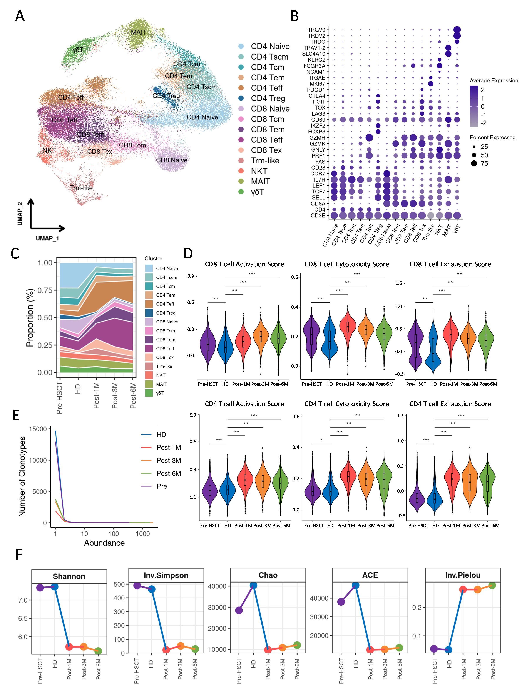

[下载 PDF](Main_Figure_02/Combined/M02.pdf) · [原始 EMF](Main_Figure_02/Combined/M02.emf) · [图级结果、代码与数据](Main_Figure_02/README.md)

精细再聚类将 T 细胞划分为 15 个转录亚群，覆盖初始、记忆、细胞毒性效应、终末耗竭、调节性及固有样 T 细胞（`Fig. 2A–B`）。移植后初始 T 细胞持续匮乏，而细胞毒性 `CD8+ Teff` 与 `CD8+ Tex` 显著扩增（`Fig. 2C`），活化、细胞毒性与终末耗竭模块评分在 `Post-1M` 达到峰值（`Fig. 2D`）。配对 scTCR-seq 表明，尽管细胞数量回升，TCR 多样性与克隆丰富度在 6 个月观察窗内仍持续受限（`Fig. 2E–F`）。

### Fig. 3 | 拟时序轨迹解析 CD8<sup>+</sup> 与 CD4<sup>+</sup> T 细胞的分叉状态转换

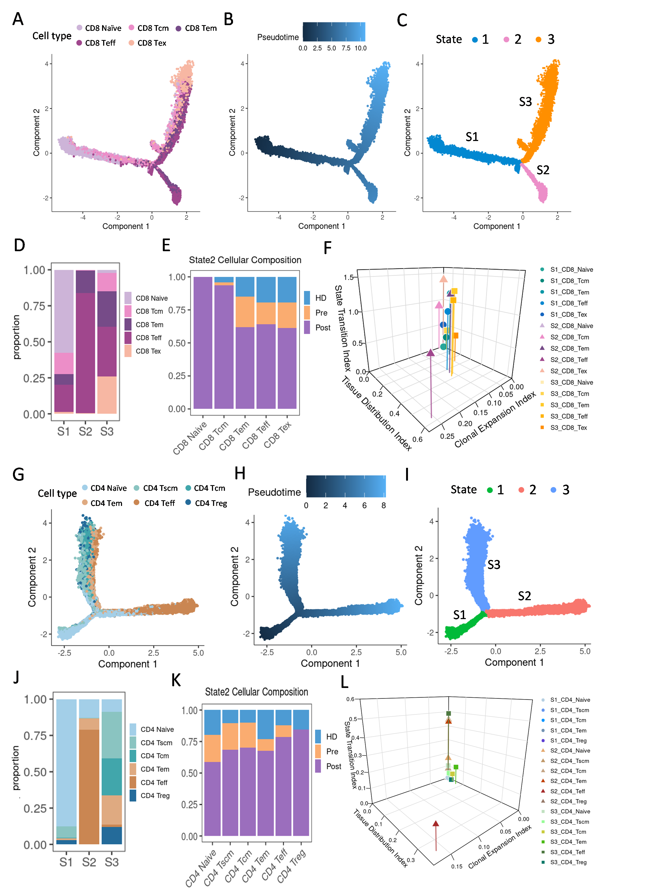

[下载 PDF](Main_Figure_03/Combined/M03.pdf) · [原始 EMF](Main_Figure_03/Combined/M03.emf) · [图级结果、代码与数据](Main_Figure_03/README.md)

Monocle2 轨迹重建显示，移植后 `CD8+` T 细胞从健康供者主导的初始根态（`State 1`）分叉进入两条终末路径：以 `S2_CD8_Teff` 为核心的高效应分支（`State 2`）以及富集 `CD8+ Tex` 与 `S3_CD8_Teff` 的耗竭倾向分支（`State 3`）（`Fig. 3A–E`）。结合 STARTRAC 三维克隆指标，`S2_CD8_Teff` 具备最突出的候选抗肿瘤反应特征（`Fig. 3F`）。`CD4+` T 细胞呈现类似分叉结构，但整体克隆扩增评分低于 `S2_CD8_Teff`（`Fig. 3G–L`）。

### Fig. 4 | 关联效应状态重塑与临床缓解的转录调控程序

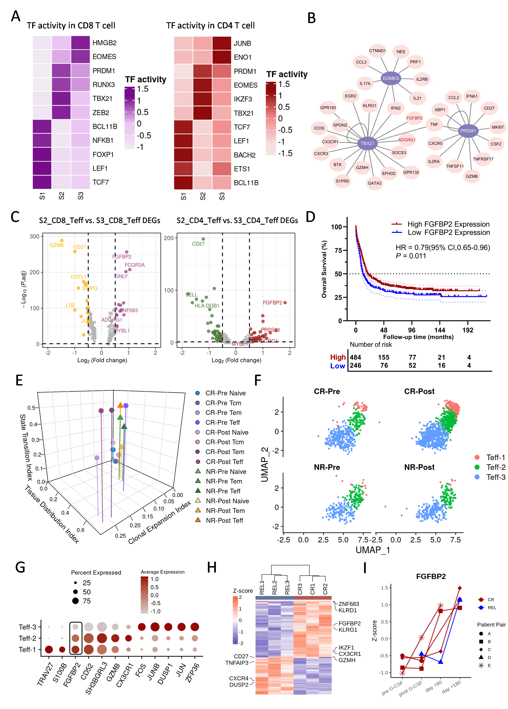

[下载 PDF](Main_Figure_04/Combined/M04.pdf) · [原始 EMF](Main_Figure_04/Combined/M04.emf) · [图级结果、代码与数据](Main_Figure_04/README.md)

VIPER 转录因子活性推断与调控网络分析表明，效应终态激活以 `TBX21`/`PRDM1`/`EOMES` 为核心的细胞毒性程序，上调 `FGFBP2`、`ADGRG1`、`PRF1` 和 `GZMH`；与 `S3_CD8_Teff`（偏高 `GZMK`、`CD27`）相比，`S2_CD8_Teff` 显著富集 `FGFBP2` 与 `ADGRG1`（`Fig. 4A–C`）。公共 AML 生存分析提示高表达 `FGFBP2` 与更长总生存期相关（`Fig. 4D`）。三个独立移植单细胞队列一致验证 `FGFBP2` 高表达效应 T 细胞表型与持续完全缓解相关：包括挽救免疫治疗应答者中 `FGFBP2+ Teff-1` 的显著扩增（`GSE223844`，`Fig. 4E–G`）、移植后 +100 天 CR 患者骨髓效应细胞更高 `FGFBP2` 表达（`GSE216187`，`Fig. 4H`）以及纵向队列中复发前下降与 DLI 后回升（`GSE222633`，`Fig. 4I`）。上述多队列结果支持临床关联性，尚不等同于直接因果证据。

### Fig. 5 | CD8<sup>+</sup> 效应亚群间的克隆结构与 TCR 序列趋同特征

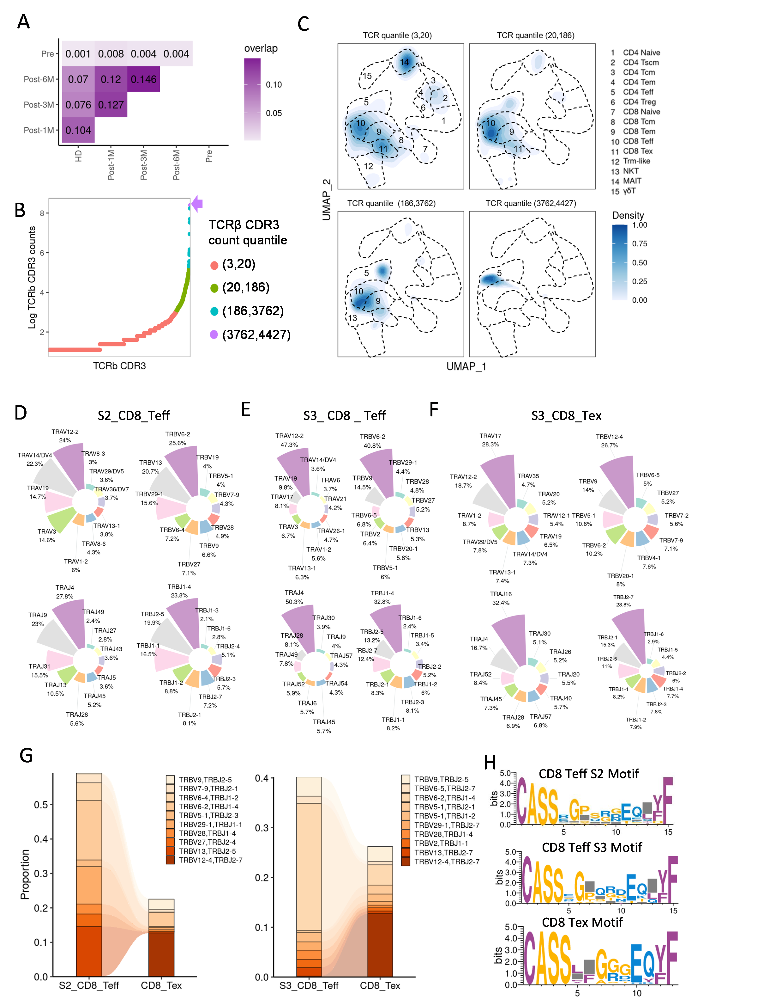

[下载 PDF](Main_Figure_05/Combined/M05.pdf) · [原始 EMF](Main_Figure_05/Combined/M05.emf) · [图级结果、代码与数据](Main_Figure_05/README.md)

纵向 TCR 相似性分析显示，移植后克隆库与供者（`HD`）的重合度远高于患者移植前基线，高扩增克隆主要定位于 `Teff` 与 `Tem` 亚群（`Fig. 5A–C`）。`S3_CD8_Teff` 呈现明显寡克隆优势，并与 `CD8_Tex` 共享大量优势 V(D)J 组合及 CDR3β 核心区（第 7–11 位）序列同源性；相比之下，`S2_CD8_Teff` 维持相对丰富的受体多样性，向耗竭终态的克隆迁移显著受限（`Fig. 5D–H`）。

---

## 补充图件导航

| 图号 | 科学标题 | 快捷链接 |
|---|---|---|
| **Fig. S1** | 移植前后样本细胞贡献及主要免疫谱系构成概览 | [PNG](Supplementary_Figures/Supplementary_Figure_01/Combined/S01.png) · [PDF](Supplementary_Figures/Supplementary_Figure_01/Combined/S01.pdf) · [图级说明](Supplementary_Figures/Supplementary_Figure_01/README.md) |
| **Fig. S2** | allo-HSCT 后 T 细胞亚群比例、CD4/CD8 比值及空间分布动态 | [PNG](Supplementary_Figures/Supplementary_Figure_02/Combined/S02.png) · [PDF](Supplementary_Figures/Supplementary_Figure_02/Combined/S02.pdf) · [图级说明](Supplementary_Figures/Supplementary_Figure_02/README.md) |
| **Fig. S3** | T 细胞发育状态来源构成及 NeoTCR 抗肿瘤特征评分验证 | [PNG](Supplementary_Figures/Supplementary_Figure_03/Combined/S03.png) · [PDF](Supplementary_Figures/Supplementary_Figure_03/Combined/S03.pdf) · [图级说明](Supplementary_Figures/Supplementary_Figure_03/README.md) |
| **Fig. S4** | 独立临床验证队列（`GSE223844`）T 细胞全景与亚群富集分析 | [PNG](Supplementary_Figures/Supplementary_Figure_04/Combined/S04.png) · [PDF](Supplementary_Figures/Supplementary_Figure_04/Combined/S04.pdf) · [图级说明](Supplementary_Figures/Supplementary_Figure_04/README.md) |
| **Fig. S5** | 独立 allo-HSCT 队列（`GSE216187`、`GSE222633`）中 FGFBP2 相关效应表型验证 | [PNG](Supplementary_Figures/Supplementary_Figure_05/Combined/S05.png) · [PDF](Supplementary_Figures/Supplementary_Figure_05/Combined/S05.pdf) · [图级说明](Supplementary_Figures/Supplementary_Figure_05/README.md) |
| **Fig. S6** | CD8<sup>+</sup> 各状态间 V(D)J 克隆连接与免疫检查点表达分布 | [PNG](Supplementary_Figures/Supplementary_Figure_06/Combined/S06.png) · [PDF](Supplementary_Figures/Supplementary_Figure_06/Combined/S06.pdf) · [图级说明](Supplementary_Figures/Supplementary_Figure_06/README.md) |

<details>
<summary><strong>点击展开内嵌预览全部补充图（Fig. S1–S6）</strong></summary>

#### Supplementary Figure 1
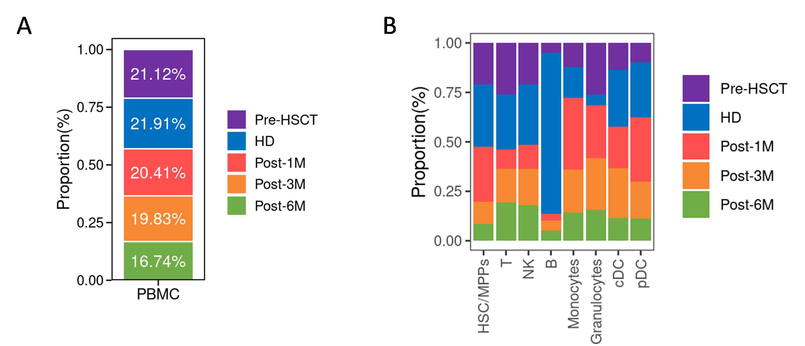

#### Supplementary Figure 2
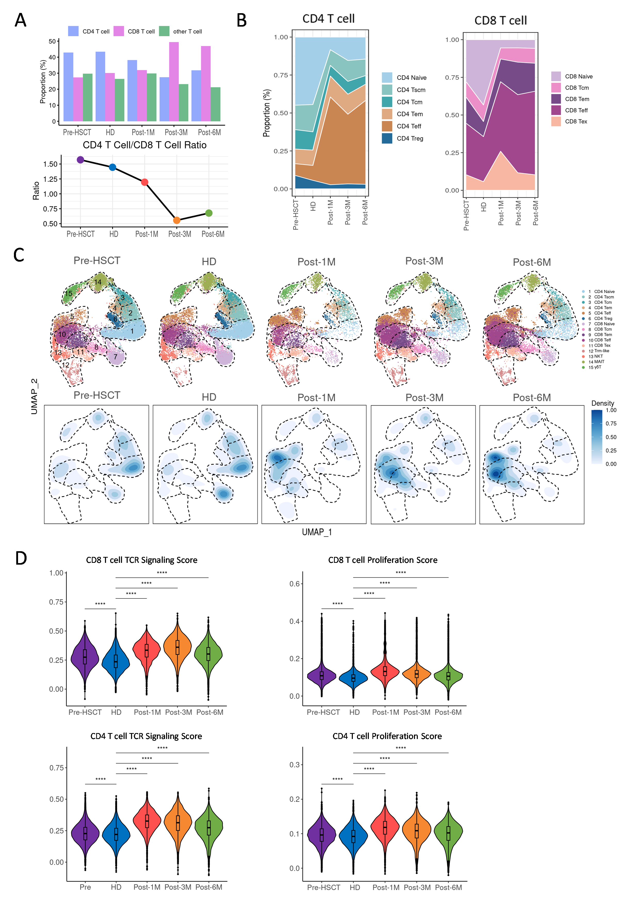

#### Supplementary Figure 3
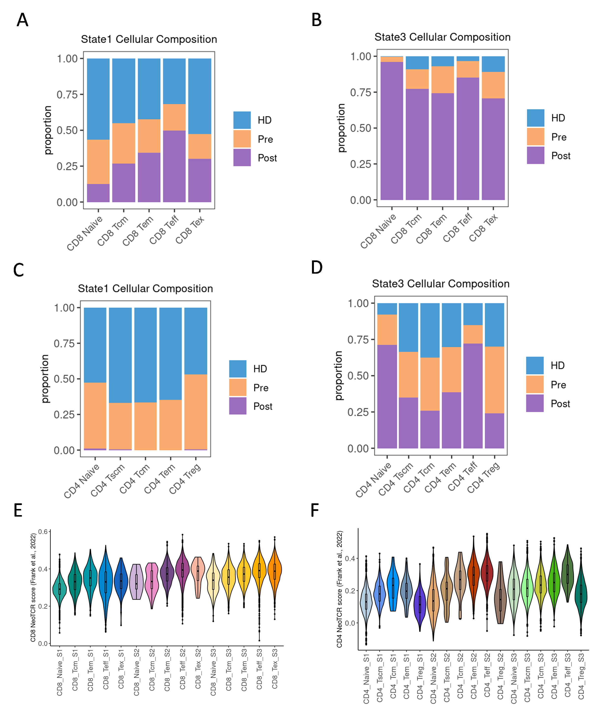

#### Supplementary Figure 4
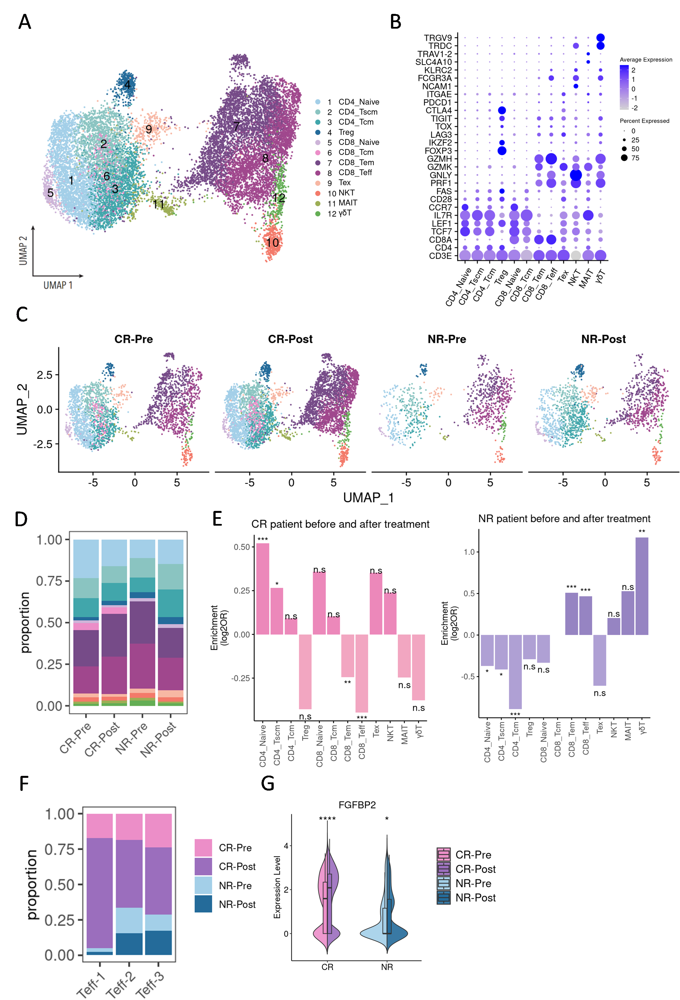

#### Supplementary Figure 5
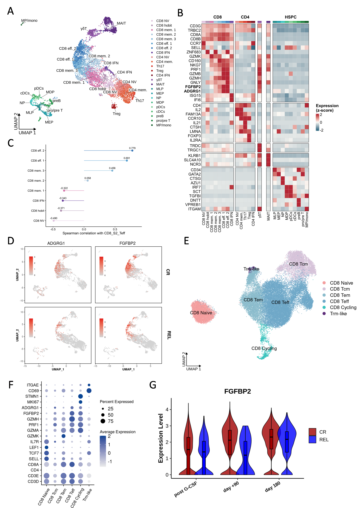

#### Supplementary Figure 6
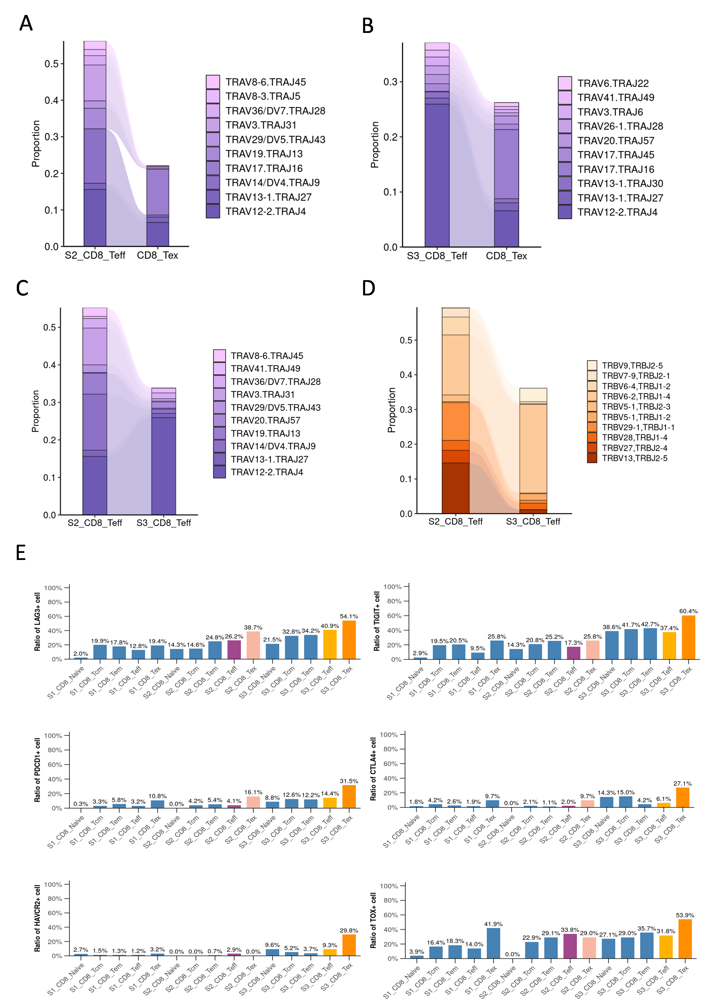

</details>

---

## 仓库结构与快速复现

```text
Project-tianyun-HSCT-FGFBP2/
├── README.md                              # 英文论文式仓库首页
├── README.zh-CN.md                        # 简体中文论文式仓库首页（当前页面）
├── docs/manuscript/                       # 投稿手稿、补充图件与审稿回复
├── 00_Settings/                           # 分图索引、锁定配色表、便携复现入口与 R 环境信息
│   ├── 00_Panel_Code_Index.tsv            # 全文 71 个分图来源与脚本总表
│   ├── 00_External_Data_Dependencies.tsv  # 服务器大型 RDS 对象路径与公共队列链接
│   ├── GLOBAL_PALETTE.md                  # 锁定配色文档（机读表：global_palette.tsv）
│   ├── 03_reproduce_primary_panels.R      # 主队列轻量表一键复现脚本（无需大型 RDS）
│   └── run_saved_plot.py                  # 统一命令行入口，在新目录安全运行复现任务
├── 00_Global_Data/Shared_Inputs/          # 导出的元数据、降维坐标、核心基因表达与绘图数据表
├── Main_Figure_01/ .. Main_Figure_05/     # 5 张主图（Combined 原图 + 分图目录 + 原始归档脚本）
└── Supplementary_Figures/                 # 6 张附图（Combined 原图 + 分图目录）
```

### 快速复现（无需下载 GB 级 Seurat 对象）

以下所有任务均直接读取本仓库随附的轻量级绘图表格并在独立新目录输出高分辨率 PDF 与 PNG。依赖环境：**Python ≥ 3.8** 与 **R（≥ 4.1.0）**（需安装 `data.table`、`ggplot2`、`scales`、`ggrepel`、`ComplexHeatmap`、`circlize`、`jsonlite`，详见 [R_sessionInfo.txt](00_Settings/R_sessionInfo.txt)）。

```bash
# 1. 查看全部已验证的可运行轻量表复现任务
python 00_Settings/run_saved_plot.py --list

# 2. 直接从导出轻量表复现主队列核心图件（Fig. 1–3, S1–S3, S6E）
python 00_Settings/run_saved_plot.py primary_all --output /path/to/repro_primary

# 3. 复现外部验证队列图件（Fig. 4H, 4I, S5B, S5C, S5E–G）
python 00_Settings/run_saved_plot.py M04h  --output /path/to/repro_M04h
python 00_Settings/run_saved_plot.py M04i  --output /path/to/repro_M04i
python 00_Settings/run_saved_plot.py S05b  --output /path/to/repro_S05b
python 00_Settings/run_saved_plot.py S05c  --output /path/to/repro_S05c
python 00_Settings/run_saved_plot.py S05ef --output /path/to/repro_S05ef
python 00_Settings/run_saved_plot.py S05f  --output /path/to/repro_S05f
python 00_Settings/run_saved_plot.py S05g  --output /path/to/repro_S05g
```

如需在计算服务器上从原始已拟合对象重新导出主队列轻量输入表（不重新聚类或重拟合）：

```bash
Rscript 00_Settings/01_export_Tcell_plot_inputs.R /path/to/HSCT/Result /path/to/exported_inputs
Rscript 00_Settings/02_export_PBMC_plot_inputs.R  /path/to/HSCT/Result /path/to/exported_inputs
```

### 审稿透明声明与已知溯源边界

- **投稿组合图保真**：全部 11 个 `Combined/` 目录均完整保留投稿 Word 文档中的原始 EMF 矢量图及对应 PNG/PDF 预览，整理过程未对任何已发表/投稿科学结论重新拟合。
- **大型对象管理**：GB 级 Seurat / Monocle `.rds` 与 `.rda` 原始对象未纳入 Git 追踪，确切文件名、服务器路径与公开下载链接均记录在 [00_External_Data_Dependencies.tsv](00_Settings/00_External_Data_Dependencies.tsv)。
- **已知原始来源缺口**：[00_Settings/README.md](00_Settings/README.md) 逐项披露了未检索到的历史素材，包括 `Fig. 1A` 示意图可编辑源文件、`Fig. 4D` Kaplan-Meier Plotter 网页端原始病人级导出表、`Fig. S3E–F` NeoTCR 评分脚本与打分列，以及部分仅以 `.source.txt` 归档的交互分析片段。

---

## 数据获取、伦理声明与基金支持

- **数据获取**：本研究主队列的 scRNA-seq 与配对 scTCR-seq 原始及处理数据已提交至国家基因组科学数据中心（NGDC/CNCB）GSA-Human 数据库，受控访问编号 **`PRJCA067718`**；外部验证队列均来自 GEO 公共数据库（**`GSE223844`**、**`GSE216187`**、**`GSE222633`**）。
- **伦理审批**：本研究经暨南大学附属第一医院伦理委员会批准（批件号 `20220915`、`JNUECKY-20251205-012`），严格遵循《赫尔辛基宣言》，所有受试者及供者均已签署书面知情同意书。
- **基金资助**：国家自然科学基金项目（`82293632`、`82293630`、`92370107`、`82400259`；重大项目子课题 `21322312`）、中央高校基本科研业务费（`21623121`、`21625219`）、广州市科技计划项目（`202102070001`）、国家级大学生创新创业训练计划项目（`202610559052`）及王宽诚教育基金资助。

## 引用方式

如在研究中使用本仓库数据、细胞注释或分析流程，请引用：

> Tian Y, Zhang Y, Zheng J, Yu B, Sun Y, Chen S, Zhong L, Zha X, Chen J, Luo OJ, Li Y. *Dynamic T cell remodeling post-allogeneic hematopoietic stem cell transplantation reveals an FGFBP2-marked low-exhaustion effector T cell subset linking to sustained complete remission.* (Manuscript, Jinan University).
