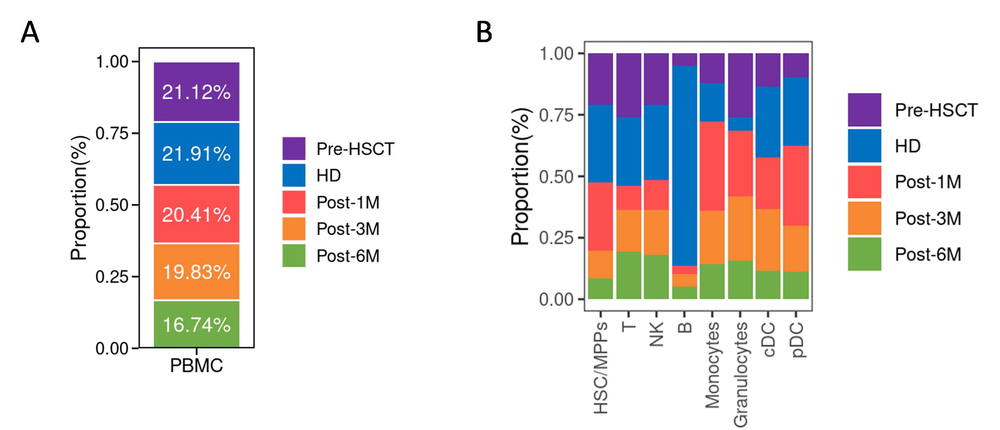

# Supplementary Figure 1 | Overview of sample distribution and immune lineage composition following HSCT.

Sample contributions and lineage proportions provide the compositional context for the longitudinal atlas.

[PDF](Combined/S01.pdf) · [Original EMF](Combined/S01.emf)

(A) Stacked bar plots represent the proportions of total sequenced cells derived from PBMCs (left) and T cells (right) across five designated time points: HD, Pre-HSCT, Post-1M, Post-3M, and Post-6M.

(B) Proportional composition of distinct immune lineages across stages. Stacked bar plot depicting the dynamic distribution of major hematopoietic lineages—including HSC/MPPs, lymphoid cells (T, NK, B), myeloid subsets (monocytes, granulocytes, cDCs, pDCs), and platelets—during immune reconstitution. 

## Panel code and data

[A](a_S01a/README.md) · [B](b_S01b/README.md)

## Figure source and execution

Combined contains the exact EMF embedded in the supplied manuscript and raster PNG/PDF previews. Server panel exports are retained where located. Panel pages identify shared inputs and original scripts. Historical interactive scripts require the documented session objects; source fragments ending in `.source.txt` are not standalone programs.

Saved cell-level inputs and trajectory geometry are in [Primary shared inputs](../../00_Global_Data/Shared_Inputs/Primary/README.md).
