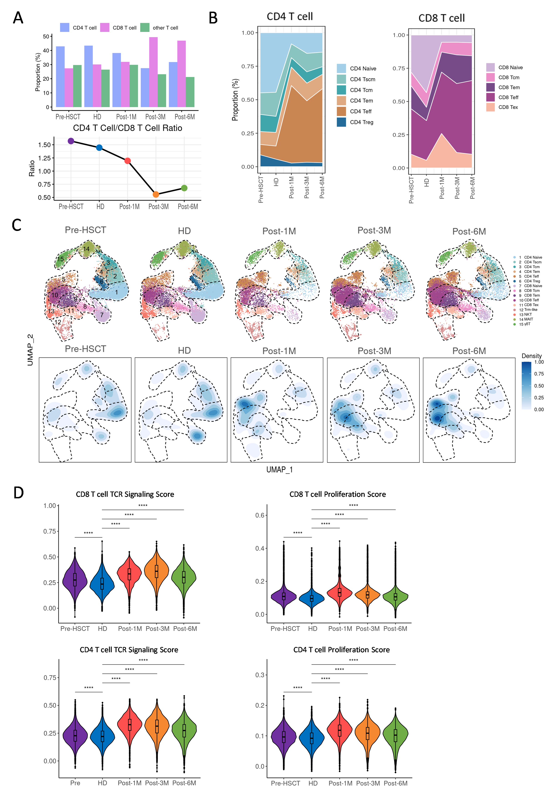

# Supplementary Figure 2 | Dynamic changes in T cell composition and spatial distribution post-allo-HSCT

> [Back to Repository Overview (EN)](../../README.md) · [返回仓库首页 (中文)](../../README.zh-CN.md)

[Download PDF](Combined/S02.pdf) · [Original EMF](Combined/S02.emf) · [Primary Shared Inputs](../../00_Global_Data/Shared_Inputs/Primary/README.md)

## Key Findings

Post-allo-HSCT reconstitution displays faster `CD8+` than `CD4+` recovery, producing a persistent inversion of the `CD4+/CD8+` ratio (`Fig. S2A`). Stage-stratified subset proportions and UMAP density projections document sustained depletion of naive compartments alongside expansion of effector and exhausted populations (`Fig. S2B–C`), accompanied by elevated TCR signaling and proliferation scores peaking at `Post-1M` (`Fig. S2D`).

## Panel Descriptions

- **(A)** Major T cell compartment proportions (`CD4+`, `CD8+`, other T cells; top) and longitudinal `CD4+/CD8+` ratio (bottom).
- **(B)** Stacked area plots of `CD4+` and `CD8+` T cell subset compositions across time points.
- **(C)** Stage-stratified T cell UMAP embeddings and corresponding density maps.
- **(D)** Violin plots of `CD4+` and `CD8+` TCR signaling and proliferation module scores across stages.

## Panel Directory

[A (`a_S02a`)](a_S02a/README.md) · [B (`b_S02b`)](b_S02b/README.md) · [C (`c_S02c`)](c_S02c/README.md) · [D (`d_S02d`)](d_S02d/README.md)

## Code & Reproduction

- **Saved-table verification**: `python 00_Settings/run_saved_plot.py M02 --output /path/to/output_M02` (outputs functional score violins covering `M02d` and `S02d` from `Tcell_metadata.csv.gz`).
- **Archived scripts**: [01_primary_landscape_and_TCR.R](../../Main_Figure_01/01_Code/01_primary_landscape_and_TCR.R) and [01_gene_set_scores.source.txt](../../Main_Figure_02/01_Code/01_gene_set_scores.source.txt).
