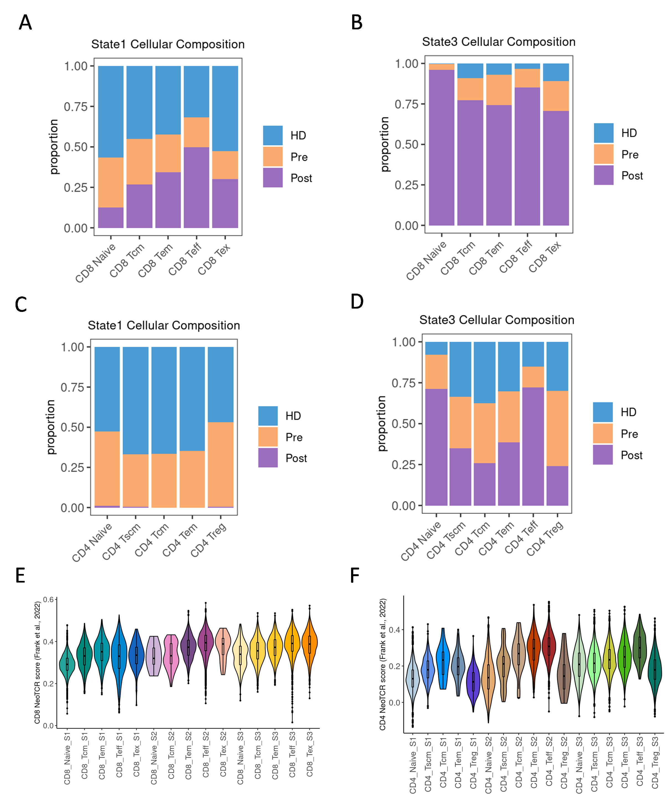

# Supplementary Figure 3 | Compositional analysis of T cell developmental states and external validation of transcriptomic signatures.

State-specific composition and NeoTCR scores further characterize the inferred T cell states.

[PDF](Combined/S03.pdf) · [Original EMF](Combined/S03.emf)

(A-B) Distribution of CD8+ T cell subsets across inferred states. Stacked bar plots illustrating the relative contribution of samples from HD, Pre-HSCT, and Post-HSCT stages to the specific CD8+ T cell subsets within State 1 (A) and State 3 (B).

(C-D) Distribution of CD4+ T cell subsets across inferred states. Stacked bar plots depicting the sample source composition (HD, Pre-HSCT, and Post-HSCT) for CD4+ T cell clusters within State 1 (C) and State 3 (D).

(E-F) External validation of anti-tumor reactivity profiles. Violin plots display the NeoTCR scores—quantified using a validated transcriptomic gene set characteristic of neoantigen-selected tumor-specific T cells (Frank et al., 2022)—across specific CD8⁺ (E) and CD4⁺ (F) T cell state-specific subsets encompassing states S1, S2, and S3 (e.g., Teff_S2, Tex_S3). The distinct enrichment of this signature highlights the antigen-responsive and anti-leukemic effector potential of the reconstituted T cell compartment.

## Panel code and data

[A](a_S03a/README.md) · [B](b_S03b/README.md) · [C](c_S03c/README.md) · [D](d_S03d/README.md) · [E](e_S03e/README.md) · [F](f_S03f/README.md)

## Figure source and execution

Combined contains the exact EMF embedded in the supplied manuscript and raster PNG/PDF previews. Server panel exports are retained where located. Panel pages identify shared inputs and original scripts. Historical interactive scripts require the documented session objects; source fragments ending in `.source.txt` are not standalone programs.

Saved cell-level inputs and trajectory geometry are in [Primary shared inputs](../../00_Global_Data/Shared_Inputs/Primary/README.md).
