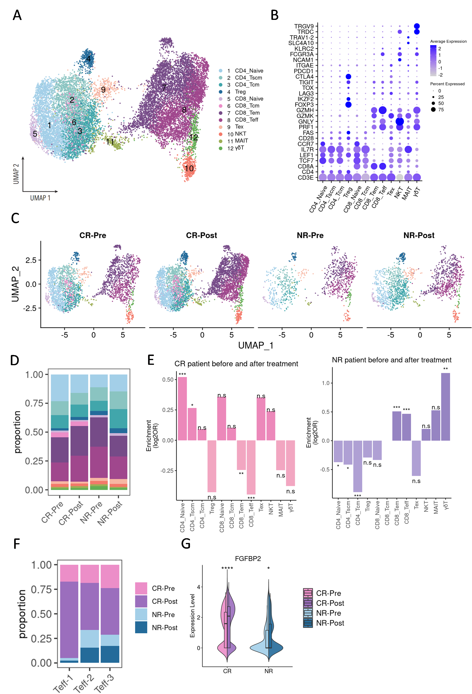

# Supplementary Figure 4 | T cell landscape and enrichment analysis in the independent clinical validation cohort (GSE223844)

> [Back to Repository Overview (EN)](../../README.md) · [返回仓库首页 (中文)](../../README.zh-CN.md)

[Download PDF](Combined/S04.pdf) · [Original EMF](Combined/S04.emf) · [GSE223844 Shared Inputs](../../00_Global_Data/Shared_Inputs/GSE223844/README.md)

## Key Findings

Reanalysis of bone marrow T cells from eight relapsed post-allo-HSCT AML patients treated with decitabine plus ipilimumab (`GSE223844`; 3 `CR`, 5 `NR`) resolves 12 transcriptionally distinct T cell clusters (`Fig. S4A–C`). Patients achieving complete remission exhibit marked post-treatment enrichment of `CD8+ Teff` cells and expansion of the `FGFBP2`-high `Teff-1` subcluster, whereas non-responders show enrichment of exhausted T cells (`Fig. S4D–G`).

## Panel Descriptions

- **(A–B)** Integrated T cell UMAP (`A`) and canonical marker expression (`B`) across 12 clusters in `GSE223844`.
- **(C–D)** Comparative UMAP embeddings (`C`) and stacked cluster proportions (`D`) across `CR-Pre`, `CR-Post`, `NR-Pre`, and `NR-Post`.
- **(E)** Treatment-induced cluster enrichment (`log2 OR`, Fisher's exact test with Bonferroni correction) in `CR` and `NR` patients.
- **(F–G)** Proportional composition of `CD8+ Teff` subclusters (`F`) and `FGFBP2` expression comparison between `CR` and `NR` (`G`).

## Panel Directory

[A](a_S04a/README.md) · [B](b_S04b/README.md) · [C](c_S04c/README.md) · [D](d_S04d/README.md) · [E](e_S04e/README.md) · [F](f_S04f/README.md) · [G](g_S04g/README.md)

## Code & Inputs

- **Archived scripts**: `Main_Figure_04/00_Preprocess/GSE223844/` (`01_cohort_analysis.Rmd`, `02_Tcell_analysis.Rmd`, `03_Tcell_additional_analysis.R`).
- **External cohort objects**: `/data5/tiany/RRAML/HSCTRR/T/Tcell.rds` and `Teff.rds` (public GEO accession [GSE223844](https://www.ncbi.nlm.nih.gov/geo/query/acc.cgi?acc=GSE223844)).
