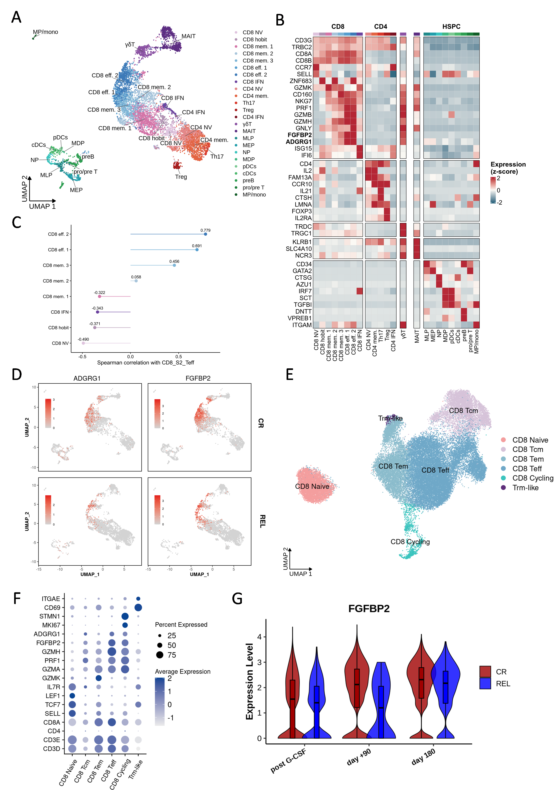

# Supplementary Figure 5 | Independent validation of the FGFBP2-associated effector T cell phenotype in AML allo-HSCT cohorts (GSE216187 & GSE222633)

> [Back to Repository Overview (EN)](../../README.md) · [返回仓库首页 (中文)](../../README.zh-CN.md)



[Download PDF](Combined/S05.pdf) · [Original EMF](Combined/S05.emf) · [Global Data Overview](../../00_Global_Data/README.md)

## Key Findings

In the day +100 post-allo-HSCT bone marrow cohort (`GSE216187`; 3 `CR`, 3 early `REL`), unbiased Spearman transcriptional similarity (excluding `FGFBP2` and `ADGRG1` to prevent circularity) confirms that external `CD8 eff. 1` and `CD8 eff. 2` clusters closely match primary `S2_CD8_Teff`, with elevated `ADGRG1`/`FGFBP2` expression in `CR` (`Fig. S5A–D`). In the longitudinal donor–recipient cohort (`GSE222633`; 5 pairs), high-resolution `CD8+` annotation verifies consistent `FGFBP2` and `ADGRG1` expression in `CD8+ Teff` across post-G-CSF, day +90, and day +180 sampling points (`Fig. S5E–G`).

## Panel Descriptions

- **(A–B)** `GSE216187` bone marrow cell landscape UMAP (`A`) and 24-celltype canonical marker expression heatmap (`B`).
- **(C)** Spearman transcriptional similarity between `GSE216187` `CD8+` subsets and primary `S2_CD8_Teff` (excluding `FGFBP2`/`ADGRG1`).
- **(D)** `ADGRG1` and `FGFBP2` feature distributions stratified by `CR` and `REL` in `GSE216187`.
- **(E–F)** `GSE222633` annotated `CD8+` T cell UMAP (`E`) and canonical marker dot plot (`F`).
- **(G)** Longitudinal `FGFBP2` expression comparisons in `CD8+ Teff` between `CR` and `REL` across post-G-CSF, day +90, and day +180 (`GSE222633`).

## Panel Directory

[A](a_S05a/README.md) · [B](b_S05b/README.md) · [C](c_S05c/README.md) · [D](d_S05d/README.md) · [E](e_S05e/README.md) · [F](f_S05f/README.md) · [G](g_S05g/README.md)

## Code & Reproduction

All saved-table panels for `Fig. S5` can be reproduced directly from compact tables included in this repository:
```bash
python 00_Settings/run_saved_plot.py S05b  --output /path/to/output_S05b
python 00_Settings/run_saved_plot.py S05c  --output /path/to/output_S05c
python 00_Settings/run_saved_plot.py S05ef --output /path/to/output_S05ef
python 00_Settings/run_saved_plot.py S05f  --output /path/to/output_S05f
python 00_Settings/run_saved_plot.py S05g  --output /path/to/output_S05g
```
