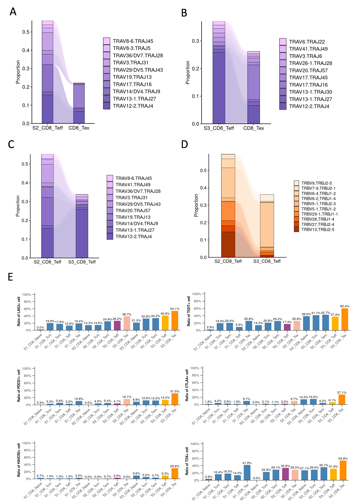

# Supplementary Figure 6 | Clonal lineage connectivity and expression profiles of immune checkpoints across T cell states.

Receptor gene usage and inhibitory-marker expression complement the clonal and transcriptional comparisons.

[PDF](Combined/S06.pdf) · [Original EMF](Combined/S06.emf)

(A–D) Inference of clonal connectivity via V(D)J usage. Alluvial plots illustrating the shared and divergent gene usage for TRAV-TRAJ between S2_CD8_Teff and CD8_Tex (A), TRAV-TRAJ between S3_CD8_Teff and CD8_Tex (B), TRAV-TRAJ between S2_CD8_Teff and S3_CD8_Teff (C), and TRBV-TRBJ between S2_CD8_Teff and S3_CD8_Teff (D). The flow thickness represents the relative proportion of specific clones, highlighting the clonal continuity and lineage transitions within the CD8+ compartment.

(E) Phenotypic quantification of exhaustion and inhibitory markers. Bar plots summarizing the percentage of cells positive for key inhibitory receptors (LAG3, TIGIT, PDCD1, CTLA4, and HAVCR2) and the master exhaustion regulator TOX across identified T cell subsets and developmental states (S1–S3). Data labels indicate the exact percentage of marker-positive cells, demonstrating a progressive increase in exhaustion features from S1 to S3.

## Panel code and data

[A](a_S06a/README.md) · [B](b_S06b/README.md) · [C](c_S06c/README.md) · [D](d_S06d/README.md) · [E](e_S06e/README.md)

## Figure source and execution

Combined contains the exact EMF embedded in the supplied manuscript and raster PNG/PDF previews. Server panel exports are retained where located. Panel pages identify shared inputs and original scripts. Historical interactive scripts require the documented session objects; source fragments ending in `.source.txt` are not standalone programs.

Saved cell-level inputs and trajectory geometry are in [Primary shared inputs](../../00_Global_Data/Shared_Inputs/Primary/README.md).
